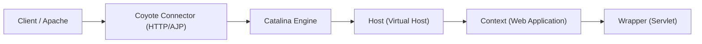
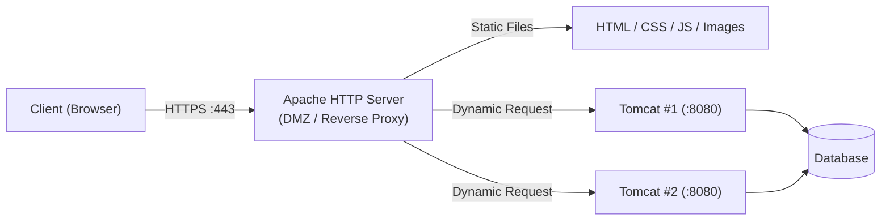

## 1. Web Server vs WAS

먼저 두 서버가 속한 계층의 개념부터 구분할 필요가 있습니다. 핵심 기준은 **정적(Static) 리소스**와 **동적(Dynamic) 리소스**입니다.

- **Web Server (웹 서버)**
  - 클라이언트의 HTTP 요청을 받아 HTML, CSS, JavaScript, 이미지 같은 **정적 콘텐츠**를 빠르고 효율적으로 제공합니다.
  - 동적 처리가 필요한 요청은 뒷단의 WAS로 전달(프록시)하고, 그 결과를 다시 클라이언트에 응답합니다.
  - 대표 제품: **Apache HTTP Server**, **Nginx**, IIS
- **WAS (Web Application Server)**
  - DB 조회나 비즈니스 로직 처리 등 매 요청마다 결과가 달라지는 **동적 콘텐츠**를 생성하여 응답합니다.
  - 내부에 웹 서버 기능을 일부 포함하고 있어 단독으로 정적 파일을 서빙할 수도 있습니다.
  - 대표 제품: **Apache Tomcat**, Jetty, Undertow, WebLogic, JEUS

| 구분 | Web Server (Apache) | WAS (Tomcat) |
| :--- | :--- | :--- |
| **주요 역할** | 정적 리소스 제공, 리버스 프록시, 로드 밸런싱 | 동적 비즈니스 로직 처리, 서블릿/JSP 실행 |
| **처리 콘텐츠** | HTML, CSS, JS, 이미지, 동영상 등 | DB 연동 결과, API 응답(JSON/XML), 템플릿 렌더링 |
| **리소스 사용** | 상대적으로 가볍고 빠름 | JVM 위에서 동작하여 메모리/CPU 사용량이 큼 |
| **단독 운영** | 정적 웹사이트 운영 가능 | 단독 서비스 가능하나, 운영 환경에서는 앞단에 Web Server 배치 권장 |

---

## 2. Apache HTTP Server

흔히 "Apache"라고 부르는 것은 **Apache HTTP Server(httpd)**를 의미합니다. 1995년부터 사용되어 온 대표적인 오픈소스 웹 서버로, 풍부한 모듈 생태계와 높은 안정성을 강점으로 가집니다.

### 주요 기능

- **정적 파일 서빙**: 파일 시스템의 정적 리소스를 캐싱과 압축(`mod_deflate`)을 적용해 빠르게 전달합니다.
- **리버스 프록시(Reverse Proxy)**: 클라이언트 요청을 받아 내부 WAS나 백엔드 서버로 전달합니다.
- **로드 밸런싱(Load Balancing)**: 여러 대의 Tomcat 인스턴스로 트래픽을 분산합니다.
- **SSL/TLS 종료(SSL Termination)**: HTTPS 암·복호화를 앞단에서 일괄 처리해 WAS의 부하를 줄입니다.
- **URL Rewrite 및 접근 제어**: `mod_rewrite`, IP 차단, Basic Auth 등 다양한 보안·라우팅 정책을 적용합니다.

### MPM (Multi-Processing Module)

Apache는 동시 접속을 처리하는 방식을 MPM 모듈로 선택할 수 있습니다.

- **Prefork**: 요청당 하나의 프로세스를 할당합니다. 메모리 사용량이 크지만 안정적이며, 스레드 안전하지 않은 모듈(구형 PHP 등)과 호환됩니다.
- **Worker**: 멀티 프로세스 + 멀티 스레드 하이브리드 방식입니다. Prefork보다 메모리를 적게 사용합니다.
- **Event**: Worker를 개선한 방식으로, Keep-Alive 연결을 별도 스레드로 관리해 동시 접속 처리 효율을 크게 높였습니다. 현대 Apache(2.4+) 환경의 기본 MPM입니다.

---

## 3. Apache Tomcat

**Apache Tomcat**은 Java 기반의 **서블릿 컨테이너(Servlet Container)**이자 경량 WAS입니다. 흔히 WAS로 분류되지만, 엄밀히 말하면 Jakarta EE(구 Java EE) 전체 스펙 중 **Servlet과 JSP 스펙을 구현한 웹 컨테이너**입니다.

> EJB, JTA 같은 전체 엔터프라이즈 스펙이 필요하지 않은 Spring 기반 애플리케이션에서는 가볍고 빠른 Tomcat이 사실상 표준처럼 사용됩니다.
{: .prompt-info }

### 핵심 컴포넌트

Tomcat은 크게 세 가지 핵심 엔진으로 구성됩니다.

1. **Coyote (HTTP / AJP Connector)**
   - 클라이언트나 앞단 웹 서버로부터 들어오는 HTTP 또는 AJP 요청을 수신하고, 처리 결과를 응답으로 돌려주는 네트워크 계층입니다.
   - 내부적으로 Thread Pool을 관리하며 동시 요청을 처리합니다.
2. **Catalina (Servlet Container)**
   - Tomcat의 핵심 엔진으로, Java Servlet의 생명주기(`init` → `service` → `destroy`)를 관리하고 요청을 적절한 서블릿으로 라우팅합니다.
3. **Jasper (JSP Engine)**
   - JSP 파일을 파싱하여 Java 서블릿 소스 코드로 변환하고 컴파일해 실행합니다.

### 내부 요청 처리 흐름



요청이 들어오면 `Connector`가 스레드 풀에서 워커 스레드를 할당하고, `Engine → Host → Context → Wrapper` 계층을 거쳐 최종 서블릿(Spring MVC에서는 `DispatcherServlet`)이 비즈니스 로직을 수행합니다.

---

## 4. 왜 Apache와 Tomcat을 함께 사용할까?

Tomcat 5.5 이후부터는 Tomcat 자체의 정적 파일 처리 성능도 크게 개선되었습니다. 그럼에도 불구하고 운영 환경에서 여전히 **Apache(또는 Nginx) + Tomcat** 구조를 사용하는 데에는 명확한 이유가 있습니다.



### 1) 역할 분리를 통한 성능 최적화
정적 리소스(이미지, JS, CSS) 요청까지 Tomcat이 처리하면, 동적 비즈니스 로직을 처리해야 할 JVM 스레드와 메모리가 낭비됩니다. Apache가 정적 리소스를 앞단에서 처리하고 동적 API 요청만 Tomcat으로 넘기면 전체 처리량(Throughput)이 향상됩니다.

### 2) 로드 밸런싱과 무중단 배포 (장애 격리)
트래픽이 증가할 때 Tomcat 인스턴스를 여러 대로 수평 확장(Scale-out)하고 Apache가 트래픽을 분산할 수 있습니다. 특정 Tomcat에 장애가 발생하거나 배포를 위해 재시작할 때도 정상 인스턴스로만 트래픽을 보내 서비스 중단을 방지할 수 있습니다.

### 3) 보안 강화 및 SSL 관리 일원화
- 외부망과 맞닿는 DMZ 구간에 Apache만 배치하고, 실제 비즈니스 로직과 DB 접근 권한을 가진 Tomcat은 내부망에 숨길 수 있습니다.
- HTTPS 인증서(SSL/TLS)를 Apache 한 곳에서 통합 관리하므로 인증서 갱신과 보안 헤더 설정이 단순해집니다.

### 4) 유연한 라우팅 (다중 백엔드 통합)
하나의 도메인 아래에서 `/api/*`는 Tomcat(Spring), `/blog/*`는 정적 사이트, `/auth/*`는 다른 서버로 분기하는 등 통합 게이트웨이 역할을 수행할 수 있습니다.

---

## 5. Apache와 Tomcat 연동 방식

Apache와 Tomcat을 연결하는 대표적인 방법은 세 가지입니다.

| 방식 | 프로토콜 | 특징 | 장단점 |
| :--- | :--- | :--- | :--- |
| **mod_jk** | AJP 1.3 | 별도 모듈(`mod_jk`) 설치 필요, `workers.properties`로 설정 | 세밀한 로드 밸런싱·세션 스티키 설정 가능 / 별도 빌드 및 설정이 복잡 |
| **mod_proxy** (`mod_proxy_http`) | HTTP / HTTPS | Apache 기본 내장 모듈 사용 | 설정이 직관적이고 유지보수 용이 / 범용적이며 보안 관리가 수월 |
| **mod_proxy_ajp** | AJP 1.3 | Apache 기본 모듈로 AJP 프로토콜 사용 | `mod_jk`보다 설정이 간단 / AJP 포트 보안 관리 필요 |

> **AJP 프로토콜 사용 시 주의사항**  
> AJP는 바이너리 프로토콜로 성능 이점이 있지만, 과거 **Ghostcat(CVE-2020-1938)** 같은 심각한 취약점이 보고된 바 있습니다. AJP 포트를 외부에 절대 노출하지 말고 `secretRequired="true"` 설정을 적용해야 하며, 특별한 이유가 없다면 현대 환경에서는 **`mod_proxy_http`** 방식을 우선 권장합니다.
{: .prompt-warning }

### `mod_proxy` 설정 예시

Apache의 `VirtualHost` 설정에서 정적 경로는 직접 서빙하고, API 요청만 Tomcat으로 프록시하는 구성입니다.

```apache
<VirtualHost *:80>
    ServerName example.com
    DocumentRoot /var/www/html

    # 정적 리소스는 프록시 제외
    ProxyPass /static !
    ProxyPass /assets !

    # 동적 요청을 Tomcat으로 전달
    ProxyPreserveHost On
    ProxyPass / http://127.0.0.1:8080/
    ProxyPassReverse / http://127.0.0.1:8080/
</VirtualHost>
```

여러 대의 Tomcat으로 로드 밸런싱할 때는 `mod_proxy_balancer`를 함께 사용합니다.

```apache
<Proxy "balancer://tomcat-cluster">
    BalancerMember http://10.0.0.11:8080 route=node1
    BalancerMember http://10.0.0.12:8080 route=node2
    ProxySet lbmethod=byrequests
</Proxy>

ProxyPass /api balancer://tomcat-cluster/api
ProxyPassReverse /api balancer://tomcat-cluster/api
```

---

## 6. 요즘 실무에서는 어떻게 쓸까? (Spring Boot & Nginx)

최근 백엔드 아키텍처에서는 전통적인 **외장 Tomcat(WAR 배포) + Apache** 조합보다 다음과 같은 구성이 훨씬 보편화되었습니다.

- **Spring Boot 내장 Tomcat (Embedded Tomcat)**: 별도로 Tomcat을 설치해 WAR 파일을 배포하는 대신, 애플리케이션 JAR 안에 Tomcat을 내장해 실행합니다. 컨테이너(Docker/Kubernetes) 환경에서 배포와 확장이 훨씬 단순해집니다.
- **Nginx 또는 Cloud Load Balancer**: 앞단 웹 서버로 이벤트 기반(Event-Driven) 비동기 아키텍처인 **Nginx**나 AWS ALB 같은 관리형 로드 밸런서를 많이 사용합니다.

다만 도구만 Nginx나 ALB로 바뀌었을 뿐, **앞단에서 정적 파일·SSL·로드 밸런싱을 처리하고 뒷단 WAS에서 비즈니스 로직을 수행하는 계층 분리 원리**는 Apache + Tomcat 구조와 완전히 동일합니다.

---

## 정리

- **Apache HTTP Server**는 정적 콘텐츠 제공, 리버스 프록시, 로드 밸런싱, SSL 종료를 담당하는 **Web Server**입니다.
- **Apache Tomcat**은 Java Servlet/JSP를 실행해 동적 콘텐츠를 생성하는 **서블릿 컨테이너(WAS)**입니다.
- 두 서버를 함께 연동하면 **성능 최적화, 장애 격리(무중단 배포), 보안 강화** 측면에서 큰 이점을 얻을 수 있으며, 연동 방식으로는 설정이 간단하고 범용적인 **`mod_proxy`(HTTP)** 방식이 널리 쓰입니다.
