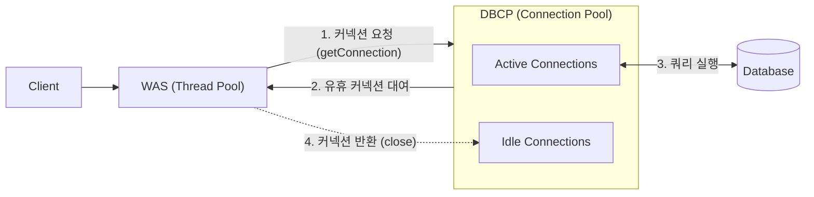

## 1. DBCP(Database Connection Pool)란?

**DBCP(Database Connection Pool)**는 애플리케이션이 데이터베이스(DB)와 통신할 때 매 요청마다 커넥션을 새로 생성하고 닫는 대신, **일정 개수의 DB 커넥션을 미리 만들어 풀(Pool)에 보관해 두고 재사용하는 기법(또는 라이브러리)**입니다.

### 왜 커넥션을 매번 새로 만들면 안 될까?

애플리케이션이 DB와 새로운 커넥션을 맺는 과정은 생각보다 비용이 큰 작업입니다.

1. **네트워크 연결 (TCP 3-Way Handshake)**: 애플리케이션 서버와 DB 서버 간 소켓 연결을 수립합니다. (TLS 사용 시 핸드셰이크 추가)
2. **인증 및 세션 초기화**: DB 계정 인증, 권한 확인, 문자셋·트랜잭션 격리 수준 등 세션 리소스를 할당합니다.
3. **연결 종료 (TCP 4-Way Handshake)**: 쿼리가 끝나면 연결을 해제하고 할당된 메모리를 정리합니다.

트래픽이 적은 환경에서는 체감이 크지 않지만, 초당 수백~수천 건의 요청이 들어오는 서비스에서 매 요청마다 커넥션을 생성·종료하면 **응답 지연(Latency) 증가**는 물론 **DB의 CPU·메모리 자원이 고갈**되어 장애로 이어질 수 있습니다.

> **DBCP의 두 가지 핵심 효과**  
> 1. **성능 향상**: 이미 연결된 커넥션을 빌려 쓰고 반환하므로 연결 수립/해제 오버헤드가 사라집니다.  
> 2. **DB 보호(유량 제어)**: 최대 커넥션 수를 제한함으로써 트래픽이 급증하더라도 DB가 감당할 수 있는 수준 이상으로 동시 연결이 폭주하는 것을 막아줍니다.
{: .prompt-info }

---

## 2. DBCP 동작 원리

DBCP는 WAS(예: Tomcat) 내부의 스레드 풀과 데이터베이스 사이에서 커넥션의 생명주기를 관리합니다.

1. **풀 초기화 (Initialization)**: 애플리케이션 기동 시 설정된 최소 개수만큼 DB 커넥션을 미리 생성해 **유휴(Idle)** 상태로 보관합니다.
2. **커넥션 대여 (`getConnection`)**: 요청을 처리하는 워커 스레드가 DB 작업이 필요해지면 풀에서 유휴 커넥션 하나를 빌려 **활성(Active)** 상태로 전환합니다.
3. **쿼리 실행**: 빌린 커넥션을 통해 SQL을 실행하고 결과를 받습니다.
4. **커넥션 반환 (`close`)**: 애플리케이션 코드에서 `connection.close()`를 호출하면 물리적인 TCP 연결을 끊는 대신, 커넥션 상태를 초기화해 풀의 **유휴(Idle)** 상태로 되돌려 놓습니다.
5. **대기 및 타임아웃**: 풀의 모든 커넥션이 사용 중이면 새 요청은 대기 큐(Wait Queue)에서 기다립니다. 지정된 대기 시간 안에 커넥션을 얻지 못하면 예외(`SQLTransientConnectionException` 등)를 발생시킵니다.

---

## 3. 주요 DBCP 구현체 비교

Java/Spring 생태계에서 널리 사용되거나 거론되는 대표적인 DBCP 구현체는 다음과 같습니다.

| 구분 | HikariCP | Apache Commons DBCP2 | Tomcat JDBC Connection Pool |
| :--- | :--- | :--- | :--- |
| **특징** | 경량화·바이트코드 수준 최적화, 압도적인 성능 | Apache Commons Pool2 기반의 전통적인 구현체 | Tomcat 환경에 최적화된 경량 풀 |
| **Spring Boot 기본값** | **Spring Boot 2.0+ 기본 채택** | 과거 Spring Boot 1.x 등에서 사용 | Spring Boot 1.x 기본 채택 |
| **성능 / 오버헤드** | 매우 빠름, 메모리 사용량 적음 | 상대적으로 무거움 | 양호함 |
| **비고** | 현재 Java 백엔드 생태계의 사실상 표준 | 레거시 시스템에서 주로 유지보수 | Tomcat 외 환경에서는 사용 빈도 감소 |

### HikariCP가 빠른 이유

HikariCP는 단순히 가벼운 것을 넘어 내부 자료구조와 동시성 처리까지 극한으로 최적화되어 있습니다.

- **`ConcurrentBag`**: `ThreadLocal` 캐시를 활용해 같은 스레드가 직전에 사용했던 커넥션을 우선 재사용하고, 락 경합(Lock Contention)을 최소화하는 Lock-Free에 가까운 구조로 설계되었습니다.
- **`FastList`**: Java 표준 `ArrayList`의 매 호출마다 수행되는 범위 검사(`rangeCheck`)를 제거하고, 역순 탐색으로 최근에 열린 `Statement`를 빠르게 정리합니다.
- **최소화된 기능과 바이트코드 최적화**: 불필요한 기능을 덜어내고 JIT 컴파일러가 인라이닝하기 쉬운 간결한 메서드로 구성되어 있습니다.

---

## 4. 실무 주의사항

1. **커넥션 풀을 무작정 크게 잡지 않기**
   - 활성 커넥션이 지나치게 많아지면 DB 내부에서 **컨텍스트 스위칭(Context Switching)**과 **락 경합(Lock Contention)**이 급증해 오히려 전체 처리량(Throughput)이 떨어집니다.
   - 커넥션 하나당 DB 메모리를 점유하므로 과도한 커넥션은 DB의 OOM(Out Of Memory)을 유발할 수 있습니다.
   - 다중 서버(Scale-out) 환경에서는 모든 애플리케이션 인스턴스의 커넥션이 하나의 DB로 모이므로, DB가 감당할 수 있는 최대 연결 한도를 넘지 않도록 주의해야 합니다.
2. **트랜잭션 내 외부 I/O 호출 분리**
   - `@Transactional` 범위 안에서 외부 API 호출이나 무거운 파일 I/O를 수행하면, 실제로 DB 쿼리를 실행하지 않는 시간 동안에도 **DB 커넥션을 계속 점유**하게 됩니다.
   - 외부 통신은 반드시 트랜잭션 바깥으로 분리해야 커넥션 고갈을 예방할 수 있습니다.
3. **커넥션 풀 데드락(Pool Deadlock) 주의**
   - 하나의 스레드가 트랜잭션 내부에서 `REQUIRES_NEW` 등으로 **동시에 2개 이상의 커넥션을 요구**하는 구조라면, 모든 스레드가 1개씩 커넥션을 쥔 채 두 번째 커넥션을 무한 대기하는 **풀 데드락**이 발생할 수 있습니다.
   - 중첩 트랜잭션으로 새 커넥션을 여는 설계는 가급적 피하거나, 필요 시 동시성 부하 상황에서의 데드락 가능성을 반드시 검증해야 합니다.
4. **유휴 커넥션 만료(Stale Connection) 방지**
   - DB(예: MySQL의 `wait_timeout`)나 중간 방화벽·프록시가 유휴 연결을 먼저 끊어버리면, 애플리케이션은 이미 끊어진 커넥션을 꺼내 쓰려다 통신 오류를 겪게 됩니다.
   - 풀에서 관리하는 커넥션의 수명이 DB나 네트워크 장비의 유휴 타임아웃보다 짧도록 유지해, 만료 전에 안전하게 교체되도록 해야 합니다.

> **장애 전파를 막기 위한 빠른 실패(Fail-Fast)**  
> DB 지연이나 커넥션 고갈 상황에서 커넥션 획득 대기 시간을 지나치게 길게 두면, 요청을 처리하던 WAS 스레드까지 모두 대기 상태에 묶여 서버 전체가 응답 불능 상태에 빠질 수 있습니다. 적절한 타임아웃을 설정해 빠르게 실패하도록 유도하는 것이 장애 격리에 유리합니다.
{: .prompt-tip }

---

## 정리

- **DBCP**는 비용이 큰 DB 커넥션을 미리 생성해 풀에 보관하고 재사용함으로써 **응답 성능을 높이고 DB를 과부하로부터 보호**하는 핵심 컴포넌트입니다.
- Java/Spring 환경에서는 `ConcurrentBag`과 `FastList` 등 극한의 최적화를 적용한 **HikariCP**가 사실상 표준으로 사용됩니다.
- 실무에서는 **과도한 커넥션 지양, 트랜잭션 내 외부 I/O 분리, 중첩 커넥션 데드락 주의, 유휴 커넥션 만료 관리** 등을 함께 고려해 안정적으로 운영해야 합니다.
