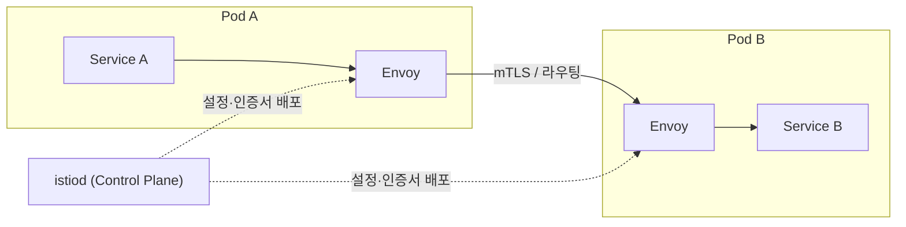

## 1. 서비스 메시(Service Mesh)란?

마이크로서비스 아키텍처(MSA)로 전환하면서 서비스가 수십, 수백 개로 나뉘면 서비스 간 내부 통신(**East-West 트래픽**)이 기하급수적으로 복잡해집니다. 서비스가 안정적으로 동작하려면 단순한 API 호출을 넘어 다음과 같은 공통 네트워크 정책이 필요합니다.

- **트래픽 제어**: 서비스 디스커버리, 로드 밸런싱, 카나리(Canary) 배포, 재시도(Retry), 타임아웃(Timeout), 서킷 브레이커(Circuit Breaker)
- **보안**: 서비스 간 통신 암호화(**mTLS**), 서비스 신원 인증 및 접근 제어
- **관측성(Observability)**: 서비스 간 호출 메트릭 수집, 액세스 로그, 분산 추적(Distributed Tracing)

이 기능들을 각 애플리케이션 코드나 라이브러리(예: Spring Cloud)로 직접 구현하면 언어·프레임워크마다 중복 개발이 발생하고, 공통 정책을 변경할 때마다 모든 서비스를 다시 빌드·배포해야 하는 부담이 생깁니다.

**서비스 메시(Service Mesh)**는 이러한 통신 정책을 애플리케이션 코드에서 완전히 분리해 **인프라 계층으로 위임**하는 아키텍처입니다. 대표적인 구현체가 바로 **Istio**와 **Envoy** 조합입니다.

> **서비스 메시가 다루는 통신의 범위**  
> 서비스 메시의 본래 목적은 서비스 ↔ 서비스 간 **내부 통신(East-West)** 제어입니다. 다만 실무에서는 외부 요청이 들어오는 **Ingress**와 외부 API로 나가는 **Egress(North-South)** 트래픽까지 Gateway를 통해 함께 통제할 수 있어, 시스템 안팎의 네트워크 통신 전반을 일관된 정책으로 관리할 수 있습니다. (단, API 스펙이나 JSON 포맷 같은 비즈니스 규약이 아니라 **라우팅·재시도·암호화·인가 같은 네트워크/전송 정책**을 담당합니다.)
{: .prompt-info }

---

## 2. Envoy란?

**Envoy**는 Lyft에서 개발해 현재 CNCF(Cloud Native Computing Foundation) 졸업 프로젝트로 관리되는 **C++ 기반 고성능 L4/L7 프록시**입니다. Istio를 비롯한 다수의 서비스 메시에서 실제 패킷을 중계하고 정책을 집행하는 **Data Plane(현장 실무자)** 역할을 맡습니다.

### Envoy는 어디에 배치되어 무엇을 할까?

Envoy는 단순히 클러스터 맨 앞단에만 서 있는 프록시가 아니라 두 곳에서 모두 동작합니다.

- **클러스터 경계 문지기 (`Ingress / Egress Gateway`)**: 외부에서 클러스터로 들어오거나 나가는 트래픽을 가장 먼저 받아 처리합니다.
- **각 서비스의 전담 비서 (`Sidecar Proxy`)**: 모든 서비스 Pod 옆에 하나씩 붙어 해당 서비스로 들어오고(Inbound) 나가는(Outbound) 모든 트래픽을 대신 처리합니다.

### 주요 기능 및 특징

- **언어 독립적(Out-of-Process) 아키텍처**: 애플리케이션 프로세스 외부에서 독립적으로 실행되므로 Java, Go, Python, Node.js 등 서비스의 언어와 무관하게 동일한 네트워크 기능을 제공합니다.
- **L4 / L7 라우팅 및 로드 밸런싱**: TCP 같은 L4 트래픽은 물론 HTTP/1.1, HTTP/2, **gRPC** 같은 L7 프로토콜을 이해하고 가중치 기반 분배(예: v1 90% / v2 10%)나 최소 요청 수(Least Request) 분산을 수행합니다.
- **동적 설정 (xDS API)**: 설정 파일을 수정하고 프로세스를 재시작할 필요 없이, **xDS(Discovery Service) API**를 통해 라우팅·클러스터·엔드포인트 정보를 실시간으로 무중단 갱신합니다.
- **장애 대응(Resilience)**: 응답 지연 시 타임아웃, 일시적 실패 시 자동 재시도, 반복 오류 인스턴스 격리(Circuit Breaking / Outlier Detection), 속도 제한(Rate Limiting)을 기본 지원합니다.
- **보안 및 관측성**: 트래픽 송수신 시 mTLS 암·복호화와 접근 제어 검증을 수행하고, Prometheus 메트릭·액세스 로그·분산 추적 헤더를 자동으로 기록합니다.

> **왜 Nginx가 아니라 Envoy가 서비스 메시의 표준이 되었을까?**  
> Nginx 역시 뛰어난 L7 프록시지만 전통적으로 정적 설정 파일 리로드 중심의 구조였습니다. 반면 Envoy는 처음부터 클라우드 네이티브 환경을 겨냥해 **xDS 기반의 실시간 동적 설정**, **네이티브 HTTP/2·gRPC 지원**, **세밀한 텔레메트리(메트릭·트레이싱)**를 핵심 설계로 채택해 서비스 메시의 사실상 표준 프록시로 자리 잡았습니다.
{: .prompt-info }

---

## 3. Istio란?

**Istio**는 Kubernetes 환경에서 가장 널리 쓰이는 오픈소스 **서비스 메시 플랫폼**입니다. Kubernetes 기본 내장 기능은 아니며, 필요에 따라 별도로 설치해(실무에서는 플랫폼 팀이 사내 표준 스택으로 구성해) 사용합니다.

수많은 Pod 옆에 배치된 Envoy 프록시들을 사람이 일일이 설정하는 것은 불가능하기 때문에, Istio는 이를 중앙에서 통합 관리하는 **Control Plane(`istiod`, 지휘관/매니저)** 역할을 수행합니다.

> **핵심: Istio는 실제 트래픽을 직접 처리하지 않는다**  
> Istio(`istiod`)는 사용자 요청이 지나가는 네트워크 경로에 직접 서 있지 않습니다. 운영자가 작성한 정책(YAML)을 해석해 모든 Envoy에게 **"어떻게 라우팅하고 암호화할지" 지시(xDS 설정 및 인증서 배포)**만 내리는 관리 매니저입니다. 실제 트래픽 전달·암호화·차단은 모두 Envoy가 수행하므로, **`istiod`가 일시적으로 중단되어도 이미 설정을 받아둔 Envoy들이 기존 트래픽을 계속 처리**할 수 있습니다.
{: .prompt-tip }

### Istio의 3대 핵심 기능

1. **트래픽 관리 (Traffic Management)**
   - 가중치 기반 라우팅(카나리 배포), HTTP 헤더 기반 라우팅(A/B 테스트), 트래픽 미러링(Shadowing), 장애 주입(Fault Injection) 등을 애플리케이션 수정 없이 선언적으로 제어합니다.
2. **보안 (Security)**
   - 내장 CA(Certificate Authority)를 통해 각 워크로드에 단기 X.509 인증서(SPIFFE 기반)를 자동 발급·갱신하여 **서비스 간 mTLS(상호 TLS)**를 강제합니다.
   - `AuthorizationPolicy`로 "주문 서비스만 결제 서비스의 `POST /pay`를 호출할 수 있다" 같은 세밀한 L7 접근 제어를 적용할 수 있습니다.
3. **관측성 (Observability)**
   - 모든 트래픽이 Envoy를 통과하므로 별도 계측 코드 없이도 요청량, 에러율, 지연 시간(Golden Signals)을 자동 수집하며 Prometheus, Grafana, Kiali, Jaeger 등과 손쉽게 연동됩니다.

---

## 4. 아키텍처: Control Plane vs Data Plane

Istio는 역할을 명확히 나누어 **Control Plane(`istiod`)**과 **Data Plane(`Envoy`)**으로 구성됩니다.

| 구분 | Control Plane (Istio / `istiod`) | Data Plane (Envoy) |
| :--- | :--- | :--- |
| **역할 비유** | 지휘관 / 관리 매니저 | 현장 실무자 |
| **핵심 역할** | 정책 해석, xDS 설정 배포, 인증서 발급 및 갱신 | 실제 트래픽 송수신, 라우팅, 암·복호화, 메트릭 수집 |
| **트래픽 경로** | 실제 데이터 트래픽 경로에 관여하지 않음 | 모든 Pod 간 트래픽을 직접 가로채서 처리 |
| **장애 영향** | 일시 중단되어도 기존 설정으로 트래픽은 계속 흐름 | 해당 Pod의 통신에 직접 영향 |

### 사이드카(Sidecar) 동작 원리

전통적인 Istio 모드에서는 네임스페이스에 **사이드카 자동 주입(Auto-Injection)**이 켜져 있어, 앱을 배포하면 Pod 안에 `[애플리케이션 컨테이너] + [istio-proxy(Envoy) 컨테이너]`가 함께 생성됩니다. (그래서 단일 앱을 배포해도 Pod 상태가 `2/2`로 표시됩니다.)

1. Pod 초기화 단계(`istio-init`)에서 `iptables`(또는 CNI) 규칙을 설정해 **Pod 바깥에서 들어오는 트래픽(Inbound)**과 **Pod 바깥으로 나가는 트래픽(Outbound)**이 모두 Envoy를 거치도록 리다이렉트합니다.
2. Service A가 `http://service-b/api`로 요청을 보내면, 같은 Pod 안의 **Envoy A**가 이를 가로채 라우팅 규칙을 적용하고 **mTLS**로 암호화해 전송합니다.
3. **Envoy B**가 요청을 받아 복호화·인가 검증을 마친 뒤 같은 Pod 안의 Service B로 전달합니다.

> **Pod 내부 컨테이너 간 통신도 Envoy가 제어할까?**  
> 아닙니다. Envoy가 제어하는 대상은 **Pod와 다른 Pod(서비스) 사이의 트래픽**입니다. 같은 Pod 안의 컨테이너끼리 `localhost`로 직접 통신하는 트래픽은 일반적으로 Envoy를 거치지 않습니다.
{: .prompt-info }

> **Ambient Mode (사이드카 없는 Istio)**  
> 모든 Pod마다 Envoy 사이드카를 띄우면 메모리·CPU 오버헤드와 수명주기 관리 부담이 발생합니다. 이를 개선하기 위해 Istio는 **Ambient Mode**를 도입했습니다. 각 노드에 공유 L4 프록시인 **ztunnel**(Rust 기반)을 배치해 mTLS와 기본 텔레메트리를 가볍게 처리하고, L7 라우팅이나 세밀한 정책이 필요한 네임스페이스/서비스에만 선택적으로 Envoy 기반 **Waypoint Proxy**를 두는 구조입니다.
{: .prompt-tip }

---

## 5. 도입 시 고려사항

Istio와 Envoy는 강력한 기능을 제공하지만, 모든 환경에 무조건 도입하는 것이 정답은 아닙니다.

> **오버헤드와 운영 복잡도**  
> - **리소스 및 지연 시간**: 사이드카 모드에서는 Pod마다 Envoy 컨테이너가 추가되므로 클러스터 전체 메모리·CPU 사용량이 늘어나고, 요청당 프록시 홉이 추가되어 미세한 지연 시간(Latency)이 발생합니다.  
> - **운영 난이도**: 수많은 CRD 리소스 관리, 네트워크 장애 시 애플리케이션·사이드카·게이트웨이 구간별 디버깅, Istio 버전 업그레이드 등 인프라 운영 역량이 요구됩니다.
{: .prompt-warning }

- **도입을 권장하는 경우**: 수십 개 이상의 마이크로서비스, 다중 언어(Polyglot) 환경, 제로 트러스트(mTLS) 보안 요구사항, 정교한 카나리·트래픽 제어가 필요한 조직
- **도입을 재고해 볼 경우**: 서비스 수가 적은 초기 단계이거나 단순 라우팅만 필요한 경우라면 Kubernetes 기본 `Service`와 Ingress / Gateway API만으로도 충분할 수 있습니다.

---

## 정리

- **서비스 메시**는 MSA 환경의 네트워크 정책(트래픽 제어·보안·관측성)을 애플리케이션 코드에서 분리해 인프라 계층에 위임하는 아키텍처로, 내부 통신(East-West)을 중심으로 외부 입출력(North-South)까지 통합 관리할 수 있습니다.
- **Envoy**는 클러스터 경계(Gateway)와 각 Pod 옆(Sidecar)에서 실제 Inbound/Outbound 트래픽을 중계·암호화·라우팅하는 **Data Plane(현장 실무자)**입니다.
- **Istio**는 **실제 트래픽을 직접 처리하지 않고**, `istiod`를 통해 수많은 Envoy에 정책(xDS)과 mTLS 인증서를 배포하는 **Control Plane(관리 매니저)**입니다.
- Istio와 Envoy는 Kubernetes 기본 내장이 아니라 필요 시 별도 설치(또는 사내 플랫폼 팀에서 표준 구성)하는 애드온이며, 리소스 오버헤드와 운영 복잡도를 함께 고려해 도입 여부를 결정해야 합니다.
