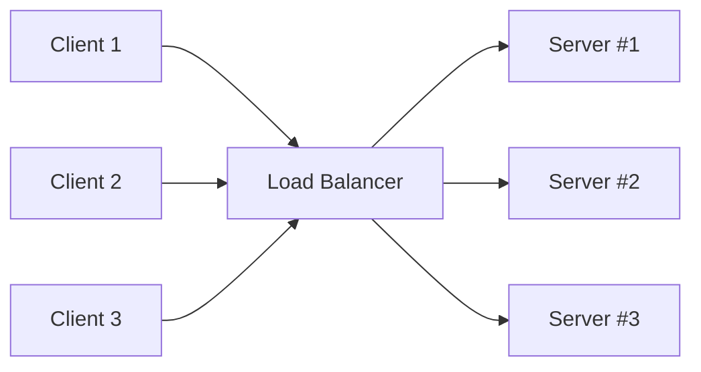
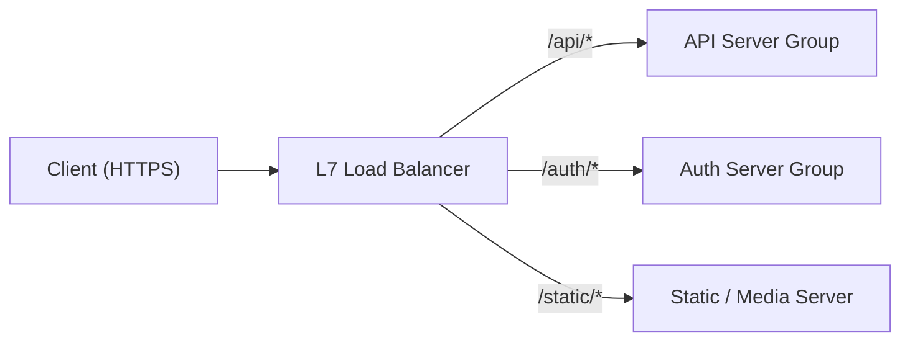

## 1. 로드 밸런서(Load Balancer)란?

**로드 밸런서(Load Balancer, 부하 분산기)**는 클라이언트가 보내는 대량의 네트워크 트래픽을 여러 대의 백엔드 서버로 균등하게 분산해 주는 장치 또는 소프트웨어입니다.

서비스 사용자가 늘어나 서버 한 대로 트래픽을 감당하기 어려워지면 크게 두 가지 확장 전략을 고려합니다.

- **Scale-up (수직 확장)**: 기존 서버의 CPU, RAM, 디스크 등 하드웨어 사양을 높이는 방식입니다. 구현이 단순하지만 물리적 한계가 있고, 비용이 기하급수적으로 증가하며 단일 장애점(SPOF)이 남습니다.
- **Scale-out (수평 확장)**: 동일한 역할을 하는 서버를 여러 대 늘려 트래픽을 나누어 처리하는 방식입니다. 이때 앞단에서 어떤 서버로 요청을 보낼지 결정해 주는 핵심 컴포넌트가 바로 **로드 밸런서**입니다.

### 로드 밸런서 도입의 핵심 이점

- **고가용성(High Availability) 및 무중단 배포**: 특정 서버에 장애가 발생하거나 배포를 위해 재시작할 때, 정상 동작 중인 서버로만 트래픽을 전달해 서비스 중단을 방지합니다.
- **확장성(Scalability)**: 트래픽 변화에 따라 백엔드 서버를 유연하게 추가하거나 제거(Auto Scaling)할 수 있습니다.
- **성능 최적화 및 보안 강화**: 앞단에서 SSL/TLS 암·복호화(SSL Termination)를 일괄 처리해 백엔드 서버의 CPU 부하를 줄이고, 내부 서버의 실제 IP를 외부로부터 숨길 수 있습니다.

---

## 2. L4 로드 밸런서 vs L7 로드 밸런서

로드 밸런서는 OSI 7계층 중 어느 계층의 정보를 바탕으로 트래픽을 분산하느냐에 따라 크게 **L4**와 **L7**으로 나뉩니다.

### L4 (Transport Layer, 전송 계층) 로드 밸런서

- **IP 주소와 포트(Port) 번호**, TCP/UDP 프로토콜 정보를 기준으로 트래픽을 분산합니다.
- 패킷의 내용(Payload)을 들여다보지 않고 커넥션 단위로 빠르게 전달하기 때문에 처리 속도가 매우 빠르고 부하가 적습니다.
- 반면 HTTP URL이나 헤더, 쿠키 값을 알 수 없으므로 세밀한 라우팅은 불가능합니다.

### L7 (Application Layer, 응용 계층) 로드 밸런서

- HTTP/HTTPS 요청의 **URL 경로, HTTP 헤더, 쿠키, 쿼리 파라미터** 등 애플리케이션 계층의 데이터를 분석하여 트래픽을 분산합니다.
- 경로 기반 라우팅(`/api/*` → API 서버, `/images/*` → 이미지 서버), 호스트 기반 라우팅, SSL 종료, WAF(웹 방화벽) 연동 등 지능적인 제어가 가능합니다.
- 패킷의 내용을 해석해야 하므로 L4에 비해 상대적으로 리소스 소모가 크고 지연 시간(Latency)이 미세하게 증가할 수 있습니다.

| 구분 | L4 로드 밸런서 | L7 로드 밸런서 |
| :--- | :--- | :--- |
| **동작 계층** | 전송 계층 (TCP / UDP) | 응용 계층 (HTTP / HTTPS / gRPC 등) |
| **분산 기준** | IP 주소, 포트 번호 | URL 경로, 호스트명, 헤더, 쿠키 등 |
| **처리 속도 / 비용** | 매우 빠름 / 상대적으로 저렴 | L4 대비 다소 느림 / 상대적으로 높음 |
| **콘텐츠 기반 라우팅** | 불가능 | 가능 (Path/Host 기반 분기) |
| **보안 기능** | 기본적인 포트/IP 수준 제어 | SSL Termination, 비정상 HTTP 요청 필터링, WAF 연동 |
| **대표 예시** | AWS NLB, LVS | AWS ALB, Nginx, HAProxy, Envoy |

> **무엇을 선택해야 할까?**  
> 일반적인 웹 서비스나 REST API, 마이크로서비스(MSA) 환경에서는 경로·호스트 기반 라우팅과 HTTPS 처리가 편리한 **L7(예: AWS ALB, Nginx)**이 표준처럼 쓰입니다. 반면에 초당 수백만 건 이상의 초고속 TCP/UDP 트래픽 처리, 고정 IP가 필요한 환경, 게임 서버·채팅 서버처럼 비 HTTP 프로토콜을 다루는 경우에는 **L4(예: AWS NLB)**가 적합합니다.
{: .prompt-info }

---

## 3. 주요 로드 밸런싱 알고리즘

로드 밸런서가 여러 대의 서버 중 어떤 서버로 요청을 보낼지 결정하는 방식은 크게 **정적(Static)** 방식과 **동적(Dynamic)** 방식으로 나뉩니다.

### 정적(Static) 알고리즘
서버의 현재 부하 상태를 실시간으로 고려하지 않고 정해진 규칙에 따라 분산합니다.

1. **라운드 로빈 (Round Robin)**
   - 들어오는 요청을 서버 목록 순서대로 번갈아 가며 할당합니다.
   - 구현이 단순하며, 모든 서버의 스펙과 처리 비용이 비슷할 때 효과적입니다.
2. **가중 라운드 로빈 (Weighted Round Robin)**
   - 각 서버의 성능에 따라 가중치(Weight)를 부여하고, 가중치가 높은 서버에 더 많은 요청을 분배합니다.
   - 서버 사양이 서로 다른 이기종 환경에 적합합니다.
3. **IP 해시 (IP Hash)**
   - 클라이언트의 IP 주소를 해싱하여 특정 서버에 고정 매핑합니다.
   - 동일한 사용자가 항상 같은 서버로 연결되므로 세션 유지에 유리하지만, 특정 IP 대역(예: NAT 뒤의 회사/학교 트래픽)에 요청이 몰리면 부하 불균형이 발생할 수 있습니다.

### 동적(Dynamic) 알고리즘
각 서버의 실시간 상태를 모니터링하여 가장 여유로운 서버로 요청을 전달합니다.

4. **최소 연결 (Least Connections)**
   - 현재 활성화된 커넥션(연결) 수가 가장 적은 서버로 새 요청을 보냅니다.
   - 요청마다 처리 시간 편차가 큰 서비스(파일 업로드, 긴 API 요청, WebSocket 등)에 유리합니다.
5. **가중 최소 연결 (Weighted Least Connections)**
   - 최소 연결 방식에 서버별 가중치를 함께 반영해 처리 용량 대비 연결 비율이 가장 낮은 서버를 선택합니다.
6. **최소 응답 시간 (Least Response Time)**
   - 활성 연결 수와 서버의 평균 응답 시간을 함께 고려해 가장 빠르게 응답할 수 있는 서버로 요청을 전달합니다.

| 알고리즘 | 유형 | 핵심 특징 | 적합한 상황 |
| :--- | :--- | :--- | :--- |
| **Round Robin** | 정적 | 순차적 균등 분배 | 서버 사양과 요청 처리 시간이 균일할 때 |
| **Weighted Round Robin** | 정적 | 서버 성능별 가중치 부여 | 서버 스펙이 서로 다를 때 |
| **IP Hash** | 정적 | 클라이언트 IP 기반 고정 매핑 | 특정 서버에 세션을 유지해야 할 때 |
| **Least Connections** | 동적 | 현재 연결 수가 가장 적은 서버 선택 | 요청 처리 시간 편차가 크거나 장시간 연결 유지 시 |
| **Least Response Time** | 동적 | 응답 시간이 가장 빠른 서버 선택 | 응답 지연(Latency) 최소화가 중요한 서비스 |

---

## 4. 다중 서버 환경에서의 세션 관리

서버가 여러 대로 늘어나면 **로그인 세션 불일치** 문제가 발생할 수 있습니다. 예를 들어 1번 서버에서 로그인했는데 다음 요청이 2번 서버로 전달되면, 2번 서버에는 세션 정보가 없어 로그인이 풀리는 현상이 생깁니다.

이를 해결하는 대표적인 방법은 두 가지입니다.

1. **Sticky Session (세션 고정)**
   - 로드 밸런서가 쿠키나 IP를 기반으로 특정 사용자의 요청을 처음 연결된 서버로 계속 보내도록 고정합니다.
   - 설정은 간단하지만, 특정 서버에 트래픽이 편중될 수 있고 해당 서버가 다운되면 세션이 유실되는 단점이 있습니다.
2. **외부 세션 저장소 / Stateless 인증 (권장)**
   - **Redis** 같은 인메모리 DB에 세션을 중앙 집중 저장하여 어떤 서버로 요청이 가든 동일한 세션을 조회하도록 구성합니다.
   - 또는 **JWT(JSON Web Token)** 기반의 무상태(Stateless) 인증을 도입해 서버가 세션 상태를 보관하지 않도록 설계합니다.

> **권장 방식**  
> Scale-out의 이점을 온전히 살리려면 Sticky Session에 의존하기보다, **Redis 기반 외부 세션 저장소**나 **JWT 기반 Stateless 아키텍처**를 사용해 어느 서버로 트래픽이 분산되어도 동일하게 동작하도록 구성하는 것이 좋습니다.
{: .prompt-tip }

---

## 정리

- **로드 밸런서**는 여러 대의 서버로 트래픽을 분산해 **고가용성, 수평 확장(Scale-out), 무중단 배포, SSL 통합 관리**를 가능하게 하는 핵심 인프라 컴포넌트입니다.
- **L4**는 IP/Port 기반으로 초고속 분산에 강하고, **L7**은 HTTP URL/헤더 기반으로 세밀한 라우팅과 보안 기능에 강합니다.
- 서비스 특성에 맞게 **Round Robin, Least Connections, IP Hash** 등의 알고리즘을 선택해 트래픽을 효율적으로 분산합니다.
- 다중 서버 환경에서의 세션 문제는 Sticky Session보다 **Redis 외부 세션 저장소**나 **Stateless(JWT)** 구조로 해결하는 것이 확장성 면에서 유리합니다.
