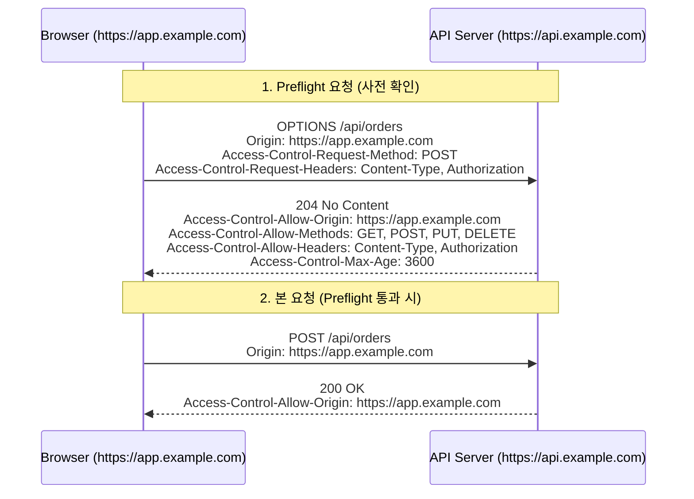

## 1. 출처(Origin)와 SOP(Same-Origin Policy)

CORS를 이해하려면 먼저 웹 브라우저가 보안을 위해 적용하는 **출처(Origin)**의 개념과 **SOP(동일 출처 정책)**을 알아야 합니다.

### 출처(Origin)란?

URL에서 **프로토콜(Scheme)**, **호스트(Host)**, **포트(Port)** 세 가지를 합친 것을 **출처(Origin)**라고 합니다. 이 세 요소가 모두 일치해야만 **동일 출처(Same-Origin)**로 판단합니다.

| 기준 URL (`https://api.example.com:443/v1/users`)과의 비교 | 동일 출처 여부 | 이유 |
| :--- | :---: | :--- |
| `https://api.example.com/v1/orders` | O | 프로토콜(`https`), 호스트(`api.example.com`), 포트(`443` 생략) 모두 일치 |
| `http://api.example.com/v1/users` | X | 프로토콜 다름 (`https` vs `http`) |
| `https://www.example.com/v1/users` | X | 호스트 다름 (`api.example.com` vs `www.example.com`) |
| `https://api.example.com:8080/v1/users` | X | 포트 다름 (`443` vs `8080`) |

### SOP(Same-Origin Policy, 동일 출처 정책)

**SOP**는 한 출처에서 로드된 문서나 스크립트(JavaScript)가 **다른 출처의 리소스에 접근(응답 읽기)하지 못하도록 제한하는 브라우저의 보안 정책**입니다.

만약 SOP가 없다면, 사용자가 악성 웹사이트에 방문했을 때 그 페이지의 스크립트가 사용자의 브라우저 쿠키를 실어 은행이나 메일 서비스로 API 요청을 보내고 응답 데이터를 탈취할 수 있습니다. SOP는 이러한 교차 출처 데이터 탈취를 기본적으로 차단합니다.

> **SOP와 CORS는 브라우저의 보안 정책입니다.**  
> 서버 간 통신(`RestTemplate`, `WebClient`), `curl`, Postman 같은 클라이언트는 SOP를 적용하지 않으므로 CORS 에러가 발생하지 않습니다. 또한 브라우저에서도 요청 자체는 서버에 도달할 수 있으며, 서버 응답에 허용 헤더가 없을 때 브라우저가 자바스크립트에 응답 전달을 차단하는 방식으로 동작합니다.
{: .prompt-info }

---

## 2. CORS(Cross-Origin Resource Sharing)란?

현대 웹 애플리케이션에서는 프론트엔드(`https://app.example.com`)와 백엔드 API 서버(`https://api.example.com`)의 출처가 다른 경우가 매우 흔합니다. 이때 백엔드 서버가 **"특정 출처의 브라우저 요청은 응답을 읽어도 좋다"**고 명시적으로 허용해 주는 표준 메커니즘이 바로 **CORS(교차 출처 리소스 공유)**입니다.

기본 흐름은 다음과 같습니다.

1. 브라우저는 교차 출처 요청을 보낼 때 `Origin` 헤더에 현재 페이지의 출처를 담아 전송합니다.
2. 서버는 해당 출처를 허용할지 판단한 뒤, 응답 헤더에 `Access-Control-Allow-Origin` 등을 포함해 반환합니다.
3. 브라우저는 응답 헤더를 확인해 요청한 출처가 허용되어 있으면 자바스크립트에 응답을 전달하고, 허용되지 않았으면 CORS 에러를 발생시켜 응답을 차단합니다.

---

## 3. CORS의 세 가지 동작 시나리오

브라우저는 요청의 성격에 따라 크게 세 가지 방식으로 CORS를 처리합니다.

### 1) 단순 요청 (Simple Request)

별도의 사전 확인(Preflight) 없이 본 요청을 바로 보내고, 서버 응답의 CORS 헤더를 검사하는 방식입니다. 다음 조건을 **모두** 만족해야 합니다.

- 메서드가 `GET`, `HEAD`, `POST` 중 하나여야 합니다.
- 수동으로 설정할 수 있는 헤더가 `Accept`, `Accept-Language`, `Content-Language`, `Content-Type` 등으로 제한됩니다.
- `Content-Type`은 아래 세 가지 값만 허용됩니다.
  - `application/x-www-form-urlencoded`
  - `multipart/form-data`
  - `text/plain`

> **실무에서는 단순 요청을 거의 보지 못합니다.**  
> 대부분의 REST API는 `Content-Type: application/json`을 사용하거나 `Authorization` 헤더에 JWT 토큰을 담아 보내기 때문에 단순 요청 조건을 벗어나며, 아래의 **프리플라이트 요청**으로 동작합니다.
{: .prompt-tip }

### 2) 프리플라이트 요청 (Preflight Request)

본 요청을 보내기 전에 브라우저가 **`OPTIONS` 메서드로 예비 요청**을 먼저 보내 서버가 해당 요청을 허용하는지 확인하는 방식입니다. 서버 상태를 변경할 수 있는 `PUT`, `DELETE` 요청이나 `application/json`, 커스텀 헤더가 포함된 요청을 안전하게 검증하기 위해 사용됩니다.

매 요청마다 `OPTIONS` 요청이 발생하면 네트워크 왕복 비용이 늘어나므로, 서버 응답에 `Access-Control-Max-Age` 헤더(초 단위)를 지정해 브라우저가 프리플라이트 결과를 캐싱하도록 설정하는 것이 좋습니다.

### 3) 인증 정보를 포함한 요청 (Credentialed Request)

쿠키(`Cookie`), `Authorization` 헤더, TLS 클라이언트 인증서 등 **민감한 인증 정보**를 포함해 교차 출처 요청을 보낼 때 동작합니다.

- **클라이언트**: Fetch API의 `credentials: 'include'` 또는 Axios의 `withCredentials: true` 옵션을 설정해야 브라우저가 쿠키를 실어 보냅니다.
- **서버**: 응답 헤더에 반드시 `Access-Control-Allow-Credentials: true`를 포함해야 합니다.
- **제약 사항**: 인증 정보를 포함하는 요청에서는 `Access-Control-Allow-Origin` 값으로 **와일드카드(`*`)를 사용할 수 없으며**, 반드시 `https://app.example.com`처럼 **정확한 출처를 명시**해야 합니다.

| 구분 | 사전 요청(`OPTIONS`) | 인증 정보(`Cookie` 등) | 와일드카드(`*`) 허용 여부 |
| :--- | :---: | :---: | :---: |
| **단순 요청 (Simple)** | X | 미포함 (기본) | O |
| **프리플라이트 (Preflight)** | O | 미포함 (기본) | O |
| **인증 정보 포함 (Credentialed)** | 조건부 발생 | 포함 (`include`) | **X (명시적 출처 필수)** |

---

## 4. 자주 겪는 트러블슈팅 및 주의사항

> **실무에서 빈번하게 마주치는 CORS 오류 원인**  
> 1. **중복 헤더 설정**: 리버스 프록시(Nginx, ALB 등)와 백엔드 애플리케이션 양쪽 모두에서 `Access-Control-Allow-Origin` 헤더를 추가하면, 응답에 값이 두 번 들어가 브라우저가 CORS 에러로 처리합니다. CORS 처리는 한 계층에서만 담당하도록 통일해야 합니다.  
> 2. **에러 응답에서의 CORS 누락**: 서버에서 `4xx`/`5xx` 에러를 반환할 때 CORS 헤더가 빠지면 브라우저는 실제 HTTP 상태 코드 대신 CORS 에러로 마스킹해 보여줍니다. 예외 핸들러나 프록시 설정에서도 에러 응답에 CORS 헤더가 유지되는지 확인해야 합니다.  
> 3. **와일드카드(`*`)와 인증 정보 충돌**: `Access-Control-Allow-Credentials: true` 상태에서 `Access-Control-Allow-Origin: *`를 지정하면 브라우저에서 거부됩니다. 여러 서브도메인을 허용해야 한다면 요청의 `Origin`을 검증한 뒤 허용 목록에 있을 때만 해당 출처를 응답 헤더에 동적으로 반영해야 합니다.  
> 4. **CORS는 서버 인증/인가의 대체제가 아닙니다**: CORS는 브라우저만 지키는 정책이므로, 악의적인 클라이언트는 브라우저 밖에서 얼마든지 API를 직접 호출할 수 있습니다. 서버 측 인증·인가 검증은 반드시 별도로 구현해야 합니다.
{: .prompt-warning }
