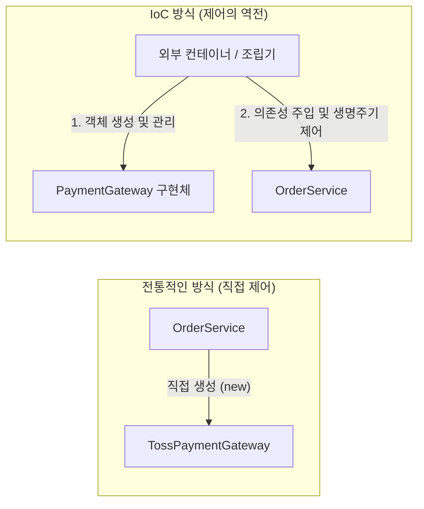
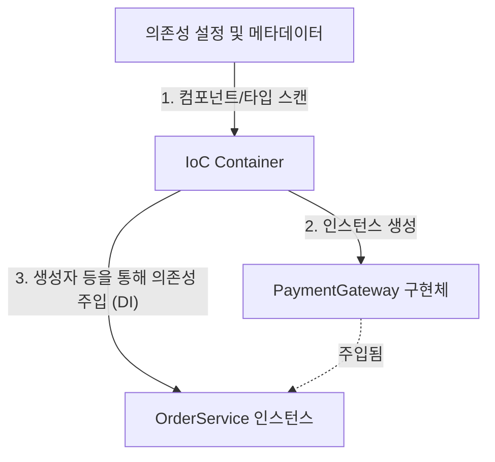

## 1. IoC (Inversion of Control, 제어의 역전)

**IoC(제어의 역전)**란 프로그램의 제어 흐름을 개발자가 직접 작성한 코드가 아니라 **외부(프레임워크, 컨테이너, 조립기 등)가 관리하도록 위임하는 범용적인 소프트웨어 설계 원칙**입니다.

특정 언어나 프레임워크(Spring 등)에 종속된 개념이 아니며, 객체지향과 모듈형 아키텍처 전반에서 결합도를 낮추기 위해 널리 활용됩니다.

### 제어 흐름의 변화

- **전통적인 제어 흐름**: 개발자의 코드가 라이브러리를 호출하고, 필요한 객체의 생성과 소멸 시점을 직접 결정합니다.
- **제어의 역전(IoC)**: 개발자는 비즈니스 로직만 구현하고, 객체의 생성·의존성 연결·메서드 호출 시점은 외부 환경이 제어합니다. 흔히 **"할리우드 원칙(Hollywood Principle: Don't call us, we'll call you)"**으로 비유됩니다.



> **IoC는 프레임워크와 라이브러리를 구분하는 핵심 기준이기도 합니다.**  
> - **라이브러리**: 개발자가 작성한 코드가 주체가 되어 필요할 때 라이브러리를 호출합니다.  
> - **프레임워크**: 프레임워크가 전체 흐름의 주체가 되어, 정해진 생명주기에 맞춰 개발자가 작성한 코드를 호출합니다.
{: .prompt-info }

---

## 2. DI (Dependency Injection, 의존성 주입)

**DI(의존성 주입)**는 IoC 원칙을 구현하는 가장 대표적인 디자인 패턴입니다. 객체가 자신이 사용할 의존 객체를 내부에서 직접 생성(`new`)하지 않고, **외부로부터 생성된 객체를 전달(주입)받는 방식**을 말합니다.

### 인터페이스와 DIP(의존관계 역전 원칙)

DI의 효과를 극대화하려면 구체 클래스가 아닌 **추상화(인터페이스)**에 의존해야 합니다. 이는 SOLID 원칙 중 **DIP(Dependency Inversion Principle)**와 맞닿아 있습니다.

```java
// 1. 추상화 (인터페이스)
public interface PaymentGateway {
    void pay(int amount);
}

// 2. 구체 구현체
public class TossPaymentGateway implements PaymentGateway {
    @Override
    public void pay(int amount) { /* 토스 결제 로직 */ }
}

// 3. 의존성을 외부에서 주입받는 클라이언트
public class OrderService {
    private final PaymentGateway paymentGateway;

    // 생성자를 통해 외부에서 구현체를 주입받음
    public OrderService(PaymentGateway paymentGateway) {
        this.paymentGateway = paymentGateway;
    }

    public void processOrder(int amount) {
        paymentGateway.pay(amount);
    }
}
```

이 구조는 프레임워크 없이도 애플리케이션 진입점(Composition Root)에서 직접 조립할 수 있습니다(**Pure DI**).

```java
// 애플리케이션 진입점(Composition Root)에서 직접 의존성을 조립
PaymentGateway gateway = new TossPaymentGateway();
OrderService orderService = new OrderService(gateway);
```

이제 `OrderService`는 `PaymentGateway` 인터페이스만 알면 되며, 실제 어떤 구현체가 들어올지는 외부에서 결정합니다. 구현체를 교체하거나 테스트용 Mock 객체를 주입하더라도 `OrderService` 코드는 수정할 필요가 없습니다.

### DI의 세 가지 주입 방식

#### 1) 생성자 주입 (Constructor Injection)

생성자를 통해 의존성을 주입받는 방식으로, **가장 권장되는 표준 방식**입니다.

```java
public class OrderService {
    private final PaymentGateway paymentGateway;

    public OrderService(PaymentGateway paymentGateway) {
        this.paymentGateway = paymentGateway;
    }
}
```

#### 2) 수정자 주입 (Setter Injection)

`setter` 메서드를 통해 의존성을 주입받는 방식입니다. 선택적이거나 런타임에 변경 가능성이 있는 의존관계에 사용합니다.

```java
public class OrderService {
    private PaymentGateway paymentGateway;

    public void setPaymentGateway(PaymentGateway paymentGateway) {
        this.paymentGateway = paymentGateway;
    }
}
```

#### 3) 필드 주입 (Field Injection)

DI 프레임워크의 기능을 이용해 클래스 필드에 직접 주입받는 방식입니다. 코드는 간결하지만 외부에서 의존성을 교체하기 어렵고 프레임워크에 강하게 종속되므로 실무에서는 지양합니다.

```java
public class OrderService {
    @Inject // 또는 @Autowired 등 프레임워크 애노테이션
    private PaymentGateway paymentGateway;
}
```

### 주입 방식 비교

| 구분 | 생성자 주입 | 수정자(Setter) 주입 | 필드 주입 |
| :--- | :--- | :--- | :--- |
| **불변성(`final`/`readonly`)** | 가능 | 불가능 | 불가능 |
| **누락 방지** | 컴파일/생성 시점에 필수 의존성 누락 확인 | 런타임 `NullPointerException` 위험 | 런타임에 발견 가능 |
| **순환 참조 감지** | 객체 생성 시점에 즉시 감지 | 실행 중 메서드 호출 시 발생 | 구동 시점에 감지 어려움 (프레임워크별 상이) |
| **테스트 용이성** | 프레임워크 없이 순수 코드로 단위 테스트 용이 | `setter` 호출 필요 | 컨테이너나 리플렉션 없이는 테스트 불가 |
| **권장 여부** | **가장 권장** | 선택적 의존성에 제한적 사용 | **비권장** |

---

## 3. IoC와 DI의 관계, 그리고 IoC 컨테이너

두 용어는 함께 자주 언급되지만 계층과 의미가 다릅니다.

- **IoC**: 제어의 흐름이 역전된다는 **넓은 개념의 설계 원칙**입니다. DI 외에도 이벤트 리스너(콜백), 템플릿 메서드 패턴, 서비스 로케이터(Service Locator) 등 다양한 방식으로 구현할 수 있습니다.
- **DI**: IoC를 실현하기 위한 **구체적인 구현 패턴** 중 하나로, 의존 객체를 외부에서 주입해 결합도를 낮추는 데 초점을 맞춥니다.

### IoC(DI) 컨테이너의 동작 구조

규모가 커지면 개발자가 수동으로 모든 객체를 조립하기 번거로워지므로, 많은 프레임워크와 라이브러리가 **IoC(DI) 컨테이너**를 제공합니다.



1. **컴포넌트 등록 및 메타데이터 스캔**: 설정 파일, 애노테이션, 데코레이터, 타입 정보 등을 읽어 관리할 객체 목록을 파악합니다.
2. **인스턴스 생성 및 의존성 해결**: 객체 간의 의존 그래프를 분석해 필요한 순서대로 인스턴스를 생성합니다.
3. **의존성 주입(DI)**: 생성된 객체를 다른 객체의 생성자나 속성에 주입하여 객체 그래프를 완성합니다.
4. **생명주기 및 스코프 관리**: 싱글톤(Singleton), 요청 단위(Request Scope) 등의 생명주기와 초기화·소멸 콜백을 컨테이너가 일관되게 관리합니다.

### 다양한 생태계에서의 DI 활용

| 생태계 / 언어 | 대표 프레임워크 및 도구 | 주요 특징 |
| :--- | :--- | :--- |
| **Java / Kotlin** | Spring (`ApplicationContext`), Guice, Dagger/Hilt | 애노테이션 기반 빈 스캔 및 생성자 주입 표준화 |
| **TypeScript / JS** | NestJS, Angular, InversifyJS, TSyringe | 데코레이터(`@Injectable`)와 타입 메타데이터 기반 DI |
| **C# / .NET** | ASP.NET Core Built-in DI | 프레임워크 레벨의 내장 컨테이너(`IServiceCollection`) 제공 |
| **Python** | FastAPI (`Depends`), dependency-injector | 함수 시그니처와 타입 힌트 기반의 의존성 주입 |
| **Go** | Google Wire, Uber Fx | 컴파일 타임 코드 생성(Wire) 또는 리플렉션 기반 조립(Fx) |

---

## 4. 실무 주의사항

1. **생성자 주입을 기본으로 사용하기**
   - 필드를 불변(`final`, `readonly` 등)으로 선언할 수 있어 객체 상태가 안전하게 유지되며, 필수 의존성 누락을 컴파일 또는 객체 생성 시점에 바로 확인할 수 있습니다.
   - 순수 코드만으로 Mock 객체를 넘겨 단위 테스트를 작성할 수 있으므로 특정 DI 프레임워크에 테스트 코드가 종속되지 않습니다.
2. **순환 참조(Circular Dependency) 주의**
   - `A`가 `B`를 의존하고 `B`가 다시 `A`를 의존하는 구조는 설계 결함의 신호입니다.
   - 생성자 주입을 사용하면 객체 조립 시점에 즉시 순환 참조 오류를 발견할 수 있습니다. 지연 로딩(`Lazy`) 등으로 우회하기보다 공통 책임을 제3의 모듈로 분리하거나 의존 방향을 단방향으로 재설계하는 것이 바람직합니다.
3. **동일 인터페이스 구현체가 여러 개일 때의 처리**
   - 하나의 인터페이스에 여러 구현체가 등록되어 있으면 컨테이너가 어떤 구현체를 주입할지 결정하지 못해 충돌이 발생합니다.
   - 기본 구현체 지정(예: Primary), 명시적 식별자 지정(예: Qualifier/토큰), 혹은 전략 패턴처럼 컬렉션(`List`/`Map`)으로 모든 구현체를 주입받아 상황에 맞게 선택하는 방식을 사용합니다.
4. **지나친 추상화와 DI 컨테이너 남용 경계**
   - 변경 가능성이 전혀 없는 단순 유틸리티나 단일 구현체까지 무조건 인터페이스로 분리하면 코드 탐색 비용만 늘어납니다. 추상화는 다형성이 필요하거나 교체 가능성이 있는 경계 지점(외부 API, 저장소, 결제 등)을 중심으로 적용하는 것이 좋습니다.
   - 소규모 프로젝트나 단순한 CLI 도구에서는 무거운 DI 컨테이너를 도입하기보다 진입점에서 직접 객체를 조립하는 **Pure DI**가 더 명확하고 디버깅하기 쉬울 수 있습니다.

> **Pure DI vs DI 컨테이너**  
> DI 패턴을 적용한다고 해서 반드시 DI 컨테이너를 써야 하는 것은 아닙니다. 프로젝트 규모가 작거나 의존 그래프가 단순하다면 코드로 직접 조립하는 Pure DI로도 DI의 장점(낮은 결합도, 테스트 용이성)을 모두 얻을 수 있습니다.
{: .prompt-tip }

---

## 정리

- **IoC(제어의 역전)**는 객체의 생성과 흐름 제어를 개발자 코드가 아닌 외부에 위임하는 **범용적인 설계 원칙**이며, **DI(의존성 주입)**는 이를 구현하는 대표적인 패턴입니다.
- 특정 프레임워크에 국한되지 않고 다양한 언어와 생태계에서 **결합도를 낮추고 테스트와 확장을 용이하게 만들기 위해** 사용됩니다.
- 실무에서는 불변성 보장, 누락 방지, 순환 참조 조기 감지를 위해 **생성자 주입을 기본 원칙**으로 삼고, 프로젝트 규모에 맞게 Pure DI와 IoC 컨테이너를 적절히 선택하는 것이 중요합니다.
