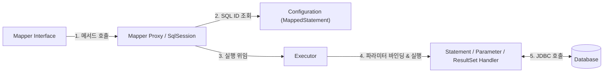

## 1. MyBatis란?

**MyBatis**는 Java 애플리케이션에서 데이터베이스와 상호작용할 때 사용하는 대표적인 **SQL Mapper 프레임워크**입니다. 개발자가 직접 작성한 SQL과 Java 객체(POJO) 간의 매핑을 자동으로 처리해 주며, XML 파일이나 애노테이션을 통해 SQL을 관리합니다.

### 왜 JDBC 대신 MyBatis를 사용할까?

순수 JDBC(Java Database Connectivity)를 직접 사용하면 비즈니스 로직보다 데이터베이스 연결과 자원 관리 코드가 훨씬 많아집니다.

1. **반복적인 보일러플레이트 코드**: `Connection` 획득, `PreparedStatement` 생성, 파라미터 바인딩, `ResultSet` 순회 및 객체 변환, `try-catch-finally` 자원 해제 코드를 매번 작성해야 합니다.
2. **SQL과 Java 코드의 혼재**: Java 소스 코드 내부에 문자열로 SQL이 섞여 들어가 가독성과 유지보수성이 떨어집니다.
3. **예외 처리의 번거로움**: 체크 예외인 `SQLException`을 매번 처리하거나 런타임 예외로 변환해야 합니다.

MyBatis는 이러한 저수준 JDBC 작업을 내부적으로 추상화하여 **개발자가 SQL 작성과 비즈니스 로직에만 집중**할 수 있도록 돕습니다.

> **SQL Mapper vs ORM**  
> - **SQL Mapper (MyBatis)**: 개발자가 **SQL을 직접 작성**하고, 그 실행 결과를 객체에 매핑합니다. SQL에 대한 완전한 제어권을 가집니다.  
> - **ORM (JPA/Hibernate)**: 객체와 테이블을 매핑해 프레임워크가 **SQL을 자동 생성**합니다. 객체 지향적인 도메인 모델링에 강점이 있습니다.
{: .prompt-info }

---

## 2. MyBatis 동작 구조

MyBatis는 애플리케이션 시작 시 설정 파일과 매퍼를 읽어 `SqlSessionFactory`를 생성하고, 요청이 들어올 때마다 `SqlSession`을 통해 SQL을 실행합니다.



### 핵심 구성 요소

- **`SqlSessionFactoryBuilder`**: MyBatis 설정 파일(`mybatis-config.xml`)이나 Java 설정을 읽어 `SqlSessionFactory`를 생성합니다. 생성 후에는 역할을 다하므로 유지할 필요가 없습니다.
- **`SqlSessionFactory`**: 애플리케이션 실행 동안 단 하나만 존재(Singleton)하며, DB 연결과 SQL 실행을 담당하는 `SqlSession`을 생성합니다.
- **`SqlSession`**: 실제 SQL 실행, 트랜잭션 커밋/롤백을 수행하는 객체입니다. **스레드에 안전하지 않으므로(Not Thread-Safe)** 요청이나 메서드 단위로 생성하고 닫아야 합니다.
- **`Mapper Interface` & `Mapper XML`**: 인터페이스의 메서드와 XML의 SQL 구문(`id`)을 1:1로 연결합니다. MyBatis가 동적 프록시(Dynamic Proxy)를 생성해 인터페이스 구현체 없이도 메서드를 호출할 수 있게 해줍니다.

> **Spring 환경에서의 `SqlSessionTemplate`**  
> Spring과 연동(`mybatis-spring`)할 때는 `SqlSessionTemplate`이 `SqlSession`을 감싸 **스레드 안전(Thread-Safe)**하게 동작하며, Spring의 트랜잭션(`@Transactional`)과 생명주기를 자동으로 동기화합니다.
{: .prompt-tip }

---

## 3. 주요 기능과 문법

### 파라미터 바인딩: `#{}` vs `${}`

MyBatis에서 파라미터를 SQL에 전달하는 방식은 크게 두 가지로 나뉘며, 동작 원리와 보안 측면에서 명확한 차이가 있습니다.

| 구분 | `#{}` (PreparedStatement 바인딩) | `${}` (문자열 직접 치환) |
| :--- | :--- | :--- |
| **동작 방식** | JDBC `PreparedStatement`의 `?` 플레이스홀더로 변환 | SQL 파싱 전 입력 값을 문자열 그대로 삽입 |
| **타입 처리** | 문자열이면 자동으로 따옴표(`'...'`) 처리 | 따옴표 없이 원문 그대로 치환 |
| **SQL Injection** | **안전함** (파라미터가 단순 값으로만 취급됨) | **취약함** (악의적인 SQL 구문 삽입 가능) |
| **실행 계획 캐싱** | 동일 SQL 구조 재사용 가능 (성능 유리) | 값에 따라 매번 다른 SQL로 인식 |
| **주요 용도** | `WHERE` 조건 값, `INSERT`/`UPDATE` 값 | 동적 테이블명, 컬럼명, `ORDER BY` 기준 |

> **`${}` 사용 시 SQL Injection 주의**  
> 사용자 입력값을 검증 없이 `${}`에 전달하면 **SQL Injection 공격**에 그대로 노출됩니다. `ORDER BY` 정렬 기준이나 테이블명을 동적으로 바꿔야 할 때는 반드시 허용된 값만 통과시키는 **화이트리스트(Whitelist) 검증**을 거쳐야 합니다.
{: .prompt-warning }

### 동적 SQL (Dynamic SQL)

MyBatis의 가장 강력한 기능 중 하나는 조건에 따라 SQL 구문을 유연하게 조합할 수 있는 동적 SQL 태그입니다.

```xml
<select id="findUsers" parameterType="UserSearchCondition" resultType="User">
    SELECT id, username, email, status
    FROM users
    <where>
        <if test="username != null and username != ''">
            AND username LIKE CONCAT('%', #{username}, '%')
        </if>
        <if test="status != null">
            AND status = #{status}
        </if>
        <if test="ids != null and !ids.isEmpty()">
            AND id IN
            <foreach item="id" collection="ids" open="(" separator="," close=")">
                #{id}
            </foreach>
        </if>
    </where>
    ORDER BY id DESC
</select>
```

- **`<where>`**: 내부 조건이 하나라도 참이면 `WHERE` 키워드를 추가하고, 맨 앞에 불필요하게 붙은 `AND`나 `OR`를 자동으로 제거해 줍니다.
- **`<set>`**: `UPDATE` 문에서 수정할 컬럼을 동적으로 나열할 때 마지막 쉼표(`,`)를 자동으로 제거합니다.
- **`<choose>`, `<when>`, `<otherwise>`**: Java의 `switch-case`와 유사하게 여러 조건 중 하나만 선택할 때 사용합니다.
- **`<foreach>`**: 리스트나 배열을 순회하며 `IN` 절이나 다건 `INSERT` 구문을 생성할 때 사용합니다.

### `resultType` vs `resultMap`

- **`resultType`**: 조회 결과의 컬럼명과 Java 객체의 필드명(또는 Setter)이 일치할 때 간단히 사용합니다. (`mapUnderscoreToCamelCase` 설정 시 `user_name` → `userName` 자동 매핑)
- **`resultMap`**: 컬럼명과 필드명이 다르거나, `1:1`(`<association>`), `1:N`(`<collection>`) 연관 관계를 가진 복잡한 중첩 객체로 매핑할 때 사용합니다.

---

## 4. 실무 주의사항

1. **`${}` 남용 및 SQL Injection 방지**
   - 일반 값 바인딩에는 예외 없이 `#{}`만 사용해야 합니다.
   - 정렬 조건이나 컬럼명 등 불가피하게 `${}`를 써야 한다면, Java 코드 단에서 `Enum`이나 `Set` 기반의 화이트리스트로 허용된 문자열인지 먼저 검증한 뒤 전달해야 합니다.
2. **`resultMap` 중첩 조회 시 N+1 문제 주의**
   - `<association>`이나 `<collection>`에서 `select` 속성을 사용해 하위 쿼리를 별도로 호출하도록 설정하면, 상위 데이터 $N$건을 조회할 때 하위 쿼리가 $N$번 추가 실행되는 **N+1 문제**가 발생할 수 있습니다.
   - 가능하면 `JOIN`으로 한 번에 데이터를 가져온 뒤 중첩 `resultMap`으로 매핑하는 방식을 우선 고려하세요.
3. **1차·2차 캐시 동작 이해**
   - **1차 캐시(Local Cache)**: 동일한 `SqlSession` 내에서 같은 쿼리를 반복 호출할 때 DB를 다시 조회하지 않고 캐시된 결과를 반환합니다. 트랜잭션 범위 밖이거나 외부에서 DB 값이 변경되는 특수한 상황에서는 `flushCache="true"` 등을 고려해야 합니다.
   - **2차 캐시(Second Level Cache)**: 매퍼 단위로 애플리케이션 전체에서 공유되는 캐시지만, 다중 서버(Scale-out) 환경에서는 인스턴스 간 캐시 정합성이 깨지기 쉬우므로 실무에서는 대부분 비활성화하고 Redis 같은 외부 캐시를 사용합니다.
4. **대용량 데이터 처리 시 메모리 관리**
   - 수십만 건 이상의 데이터를 한 번에 `List`로 조회하면 WAS에 OOM(Out Of Memory)이 발생할 수 있습니다. 대량 조회는 페이징 처리나 MyBatis의 `Cursor` / `ResultHandler`를 사용해 스트리밍 방식으로 처리해야 합니다.
   - 대량 `INSERT`/`UPDATE` 작업 시에는 `ExecutorType.BATCH`를 활용해 JDBC 배치 처리를 적용하면 네트워크 왕복 비용을 크게 줄일 수 있습니다.

---

## 정리

- **MyBatis**는 반복적인 JDBC 코드를 제거하고 **개발자가 작성한 SQL과 Java 객체를 깔끔하게 매핑**해 주는 SQL Mapper 프레임워크입니다.
- **동적 SQL(`<if>`, `<where>`, `<foreach>`)**과 **`resultMap`**을 통해 복잡한 조건 검색과 통계 쿼리를 유연하게 작성할 수 있습니다.
- 실무에서는 **`#{}` 사용 원칙 준수, 중첩 매핑 시 N+1 방지, 캐시 정합성 및 대용량 배치 처리**를 고려해 안정적으로 운영해야 합니다.
