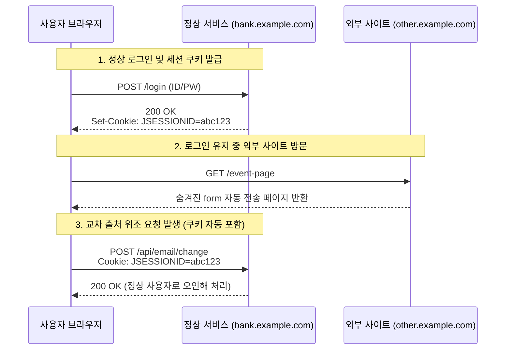

## 1. CSRF(Cross-Site Request Forgery)란?

**CSRF(사이트 간 요청 위조)**는 사용자가 웹 애플리케이션에 **로그인(인증)된 상태를 유지하고 있을 때**, 사용자의 의도와 무관하게 외부 사이트를 통해 **비밀번호 변경, 게시글 삭제, 계좌 이체 같은 상태 변경 요청이 전송되도록 유도하는 웹 보안 취약점**입니다.

### 왜 발생할까?

브라우저는 특정 도메인으로 HTTP 요청을 보낼 때, 해당 도메인에 저장된 **쿠키(세션 ID 등)를 자동으로 함께 전송**합니다.

만약 서버가 요청에 담긴 쿠키만 보고 "인증된 사용자의 정상 요청"이라고 판단한다면, 사용자가 다른 사이트에 방문했을 때 그 페이지가 몰래 보낸 요청에도 브라우저가 쿠키를 자동으로 실어 보내기 때문에 서버는 이를 정상 요청으로 오인해 처리하게 됩니다.

> **CSRF가 성립하기 위한 3가지 조건**  
> 1. **인증 상태 유지**: 사용자가 대상 서비스에 로그인되어 유효한 세션 쿠키를 가지고 있어야 합니다.  
> 2. **쿠키 기반 자동 인증**: 서버가 브라우저가 자동 전송하는 쿠키(또는 HTTP Basic Auth 등)만으로 사용자를 식별하고, 요청의 출처나 별도 토큰을 검증하지 않아야 합니다.  
> 3. **예측 가능한 요청 구조**: 외부 페이지에서 요청 URL과 파라미터 형식을 미리 구성할 수 있어야 합니다.
{: .prompt-info }

---

## 2. CSRF 동작 흐름

사용자가 은행 서비스(`bank.example.com`)에 로그인한 상태에서, 악성 링크나 외부 페이지(`other.example.com`)에 방문했을 때의 흐름은 다음과 같습니다.



1. 사용자가 정상 서비스에 로그인하면 브라우저는 해당 도메인의 세션 쿠키를 저장합니다.
2. 로그아웃하지 않은 상태로 외부 사이트에 접속하면, 해당 페이지에 포함된 숨겨진 `<form>` 자동 제출이나 링크·이미지 요청 등이 정상 서비스로 HTTP 요청을 발생시킵니다.
3. 브라우저는 요청 대상 도메인의 쿠키를 자동으로 첨부해 전송하고, 서버는 유효한 세션 쿠키를 확인한 뒤 요청을 그대로 실행합니다.

---

## 3. XSS, CORS와의 차이

CSRF는 비슷한 시기에 자주 함께 언급되는 **XSS**나 **CORS**와 혼동하기 쉽습니다.

### CSRF vs XSS

| 구분 | CSRF (Cross-Site Request Forgery) | XSS (Cross-Site Scripting) |
| :--- | :--- | :--- |
| **악용하는 신뢰 방향** | **서버가 사용자의 브라우저를 신뢰**하는 점을 악용 | **사용자가 특정 웹사이트를 신뢰**하는 점을 악용 |
| **공격 방식** | 외부 사이트에서 인증된 사용자의 권한으로 위조 요청 전송 | 정상 사이트에 악성 스크립트를 삽입해 사용자 브라우저에서 실행 |
| **쿠키/응답 탈취 여부** | 기본적으로 쿠키 값이나 응답 본문을 직접 읽지 못함 | 스크립트 실행으로 세션 정보·화면 데이터 탈취 및 조작 가능 |
| **대표 방어 기법** | CSRF 토큰, `SameSite` 쿠키, `Origin` 검증 | 입력값 검증, 출력 이스케이프(Encoding), CSP(Content Security Policy) |

> **CORS가 설정되어 있으면 CSRF를 막을 수 있을까?**  
> **아닙니다.** CORS는 교차 출처 요청의 **응답을 자바스크립트가 읽지 못하도록 차단**하는 브라우저 정책입니다. HTML `<form>` 전송이나 단순 요청(Simple Request)은 프리플라이트(`OPTIONS`) 없이 서버에 그대로 도달해 상태가 변경될 수 있으므로, CORS 설정만으로는 CSRF를 방어할 수 없습니다.
{: .prompt-tip }

---

## 4. 주요 CSRF 방어 기법

CSRF는 서버와 브라우저 양쪽의 메커니즘을 조합해 방어하는 것이 일반적입니다.

### 1) CSRF 토큰 (Synchronizer Token Pattern)

가장 널리 쓰이는 대표적인 서버 측 방어 방식입니다.

1. 사용자가 페이지에 접속하면 서버는 세션별로 **예측 불가능한 난수 토큰(CSRF Token)**을 생성해 세션에 저장하고, HTML `<form>`의 숨겨진 필드나 `<meta>` 태그로 클라이언트에 전달합니다.
2. 클라이언트가 상태 변경 요청(`POST`, `PUT`, `DELETE` 등)을 보낼 때 요청 본문이나 커스텀 헤더(`X-CSRF-TOKEN`)에 토큰을 함께 담아 전송합니다.
3. 서버는 세션에 저장된 토큰과 요청으로 들어온 토큰이 일치하는지 검증합니다.

외부 사이트는 브라우저의 **SOP(동일 출처 정책)** 때문에 정상 서비스 페이지에 담긴 CSRF 토큰 값을 읽을 수 없으므로 위조 요청을 통과시킬 수 없습니다.

*(세션을 사용하지 않는 환경에서는 쿠키와 요청 헤더/파라미터에 동일한 난수 토큰을 담아 서버에서 두 값이 일치하는지 비교하는 **Double Submit Cookie** 패턴을 사용하기도 합니다.)*

### 2) `SameSite` 쿠키 속성

`Set-Cookie` 헤더에 `SameSite` 속성을 지정하면 **교차 출처 요청 시 브라우저가 쿠키를 자동으로 전송할지 제어**할 수 있습니다.

| 속성 값 | 동작 방식 | 특징 및 권장 용도 |
| :--- | :--- | :--- |
| **`Strict`** | **동일 사이트(Same-Site)** 요청에만 쿠키 전송 | 보안성이 가장 높지만, 외부 링크를 클릭해 들어올 때도 로그인 상태가 풀릴 수 있음 |
| **`Lax`** *(최신 브라우저 기본값)* | 동일 사이트 요청 + 안전한 최상위 탐색(`GET` 링크 이동 등)에만 쿠키 전송 | 교차 출처 `POST` 폼 전송·`fetch` 등에서는 쿠키 차단. 보안과 사용성의 균형이 좋음 |
| **`None`** | 모든 교차 출처 요청에 쿠키 전송 (`Secure` 속성 필수) | 외부 도메인 간 인증 공유(SSO, 결제 연동 등)가 필요할 때만 제한적으로 사용 |

```http
Set-Cookie: JSESSIONID=abc123; Path=/; HttpOnly; Secure; SameSite=Lax
```

### 3) `Origin` / `Referer` 헤더 검증

브라우저가 요청에 자동으로 포함하는 `Origin` 또는 `Referer` 헤더 값이 서비스의 허용된 도메인인지 서버에서 확인하는 방법입니다. 구현이 간단하지만, 프록시나 브라우저 프라이버시 정책에 따라 `Referer` 헤더가 생략될 수 있으므로 단독 방어보다는 **CSRF 토큰이나 `SameSite`와 함께 쓰는 보조 수단**으로 활용합니다.

### 4) 커스텀 헤더 기반 인증 (JWT `Authorization` 헤더)

토큰(JWT 등)을 쿠키가 아닌 **`Authorization: Bearer <token>` 헤더**에 직접 담아 전송하는 SPA·모바일 API 구조에서는 브라우저가 해당 헤더를 자동으로 첨부하지 않으므로 CSRF 취약점이 발생하지 않습니다.

단, JWT를 사용하더라도 **쿠키에 저장해 자동 전송하는 구조**라면 세션 쿠키와 동일하게 CSRF 방어가 필요합니다.

---

## 5. 실무 주의사항

> **CSRF 방어 설계 시 반드시 점검해야 할 항목**  
> 1. **상태 변경 요청에 `GET` 메서드 사용 금지**: `SameSite=Lax`는 외부 링크를 통한 최상위 `GET` 탐색에는 쿠키를 전송합니다. 삭제·수정·결제 같은 상태 변경 API는 반드시 `POST`, `PUT`, `PATCH`, `DELETE` 메서드로 설계해야 합니다.  
> 2. **XSS 방어와 병행 필수**: 서비스에 XSS 취약점이 존재하면 페이지 내에서 실행된 스크립트가 CSRF 토큰을 읽어 요청을 보낼 수 있어 CSRF 방어가 무력화됩니다.  
> 3. **프레임워크 CSRF 보호 비활성화 시 주의**: Spring Security 등 주요 웹 프레임워크는 기본적으로 CSRF 보호를 제공합니다. 쿠키 인증을 전혀 쓰지 않는 순수 `Authorization` 헤더 기반 API가 아니라면 무분별하게 CSRF 보호를 끄지 않아야 합니다.  
> 4. **민감한 작업은 추가 재인증 적용**: 비밀번호 변경, 결제, 권한 변경 같은 핵심 기능에는 CSRF 방어와 별개로 현재 비밀번호 재확인이나 2단계 인증(OTP)을 적용하는 것이 안전합니다.
{: .prompt-warning }

---

## 정리

- **CSRF**는 브라우저가 요청 대상 도메인의 쿠키를 자동 전송하는 특성을 악용해, 인증된 사용자의 권한으로 의도하지 않은 상태 변경 요청을 실행시키는 취약점입니다.
- **CORS**는 교차 출처 응답 읽기를 제한할 뿐 요청 전송 자체를 막지 못하므로 CSRF 방어를 대체할 수 없습니다.
- 실무에서는 **`SameSite=Lax`(또는 `Strict`) 쿠키 설정과 CSRF 토큰 검증**을 기본으로 적용하고, 상태 변경 API에 `GET`을 사용하지 않으며, XSS 방어 및 민감 작업 재인증을 함께 갖추는 것이 안전합니다.
