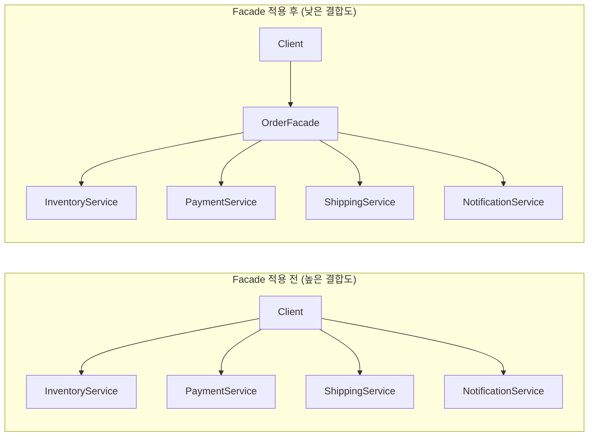

## 1. Facade Pattern(퍼사드 패턴)이란?

**Facade Pattern(퍼사드 패턴)**은 GoF(Gang of Four) 디자인 패턴 중 **구조(Structural) 패턴**에 속하며, **복잡한 서브시스템(여러 클래스, 라이브러리, API 등)의 내부 동작을 감추고 클라이언트에게 단순하고 통합된 단일 진입점(인터페이스)을 제공하는 패턴**입니다.

'Facade'는 프랑스어로 **건물의 정면(외벽)**을 뜻합니다. 건물 내부에 복잡한 배관과 전기 배선이 얽혀 있더라도 바깥에서는 깔끔한 정면만 보이듯, 시스템 내부의 복잡한 협력 과정을 숨기고 외부에는 꼭 필요한 기능만 단순하게 드러내는 것이 핵심입니다.

### 적용 전후 구조 비교



- **적용 전**: 클라이언트가 여러 서브시스템의 존재와 호출 순서, 예외 처리 방식까지 모두 알아야 합니다. 서브시스템 중 하나만 변경되어도 클라이언트 코드가 함께 수정되어야 합니다.
- **적용 후**: 클라이언트는 `Facade` 하나만 알고 호출합니다. 내부 서브시스템 간의 조합과 실행 순서는 `Facade`가 책임지므로 결합도가 크게 낮아집니다.

> **최소 지식 원칙(Law of Demeter)과의 관계**  
> 퍼사드 패턴은 객체지향 설계 원칙 중 **최소 지식 원칙("가장 가까운 친구에게만 말하라")**을 실현하는 대표적인 방법입니다. 클라이언트가 내부 구현 객체들과 직접 얽히지 않고 Facade와만 소통하도록 제한함으로써 변경의 파급 범위를 줄입니다.
{: .prompt-info }

---

## 2. 코드로 보는 Facade Pattern

온라인 쇼핑몰에서 주문을 처리할 때 **재고 확인 → 결제 → 배송 요청 → 알림 발송** 순서로 여러 서비스를 호출해야 하는 상황을 예로 들어보겠습니다.

### 1) Facade 적용 전

클라이언트(예: 컨트롤러)가 모든 서브시스템을 직접 주입받고, 호출 순서까지 직접 제어합니다.

```java
public class OrderController {
    private final InventoryService inventoryService;
    private final PaymentService paymentService;
    private final ShippingService shippingService;
    private final NotificationService notificationService;

    public OrderController(
            InventoryService inventoryService,
            PaymentService paymentService,
            ShippingService shippingService,
            NotificationService notificationService) {
        this.inventoryService = inventoryService;
        this.paymentService = paymentService;
        this.shippingService = shippingService;
        this.notificationService = notificationService;
    }

    public void placeOrder(OrderRequest request) {
        inventoryService.reserve(request.getProductId(), request.getQuantity());
        paymentService.pay(request.getUserId(), request.getAmount());
        shippingService.requestDelivery(request.getAddress(), request.getProductId());
        notificationService.sendOrderComplete(request.getUserId());
    }
}
```

이 구조에서는 다른 진입점(예: 모바일 전용 API, 배치 작업, 이벤트 컨슈머)에서 동일한 주문 로직을 실행해야 할 때마다 4개의 의존성과 호출 순서를 중복 작성해야 합니다.

### 2) Facade 적용 후

복잡한 협력 흐름을 `OrderFacade` 클래스로 캡슐화합니다.

```java
// 여러 서브시스템을 조합해 단일 진입점을 제공하는 Facade
public class OrderFacade {
    private final InventoryService inventoryService;
    private final PaymentService paymentService;
    private final ShippingService shippingService;
    private final NotificationService notificationService;

    public OrderFacade(
            InventoryService inventoryService,
            PaymentService paymentService,
            ShippingService shippingService,
            NotificationService notificationService) {
        this.inventoryService = inventoryService;
        this.paymentService = paymentService;
        this.shippingService = shippingService;
        this.notificationService = notificationService;
    }

    public void placeOrder(OrderRequest request) {
        inventoryService.reserve(request.getProductId(), request.getQuantity());
        paymentService.pay(request.getUserId(), request.getAmount());
        shippingService.requestDelivery(request.getAddress(), request.getProductId());
        notificationService.sendOrderComplete(request.getUserId());
    }
}
```

```java
// 클라이언트는 Facade 하나에만 의존
public class OrderController {
    private final OrderFacade orderFacade;

    public OrderController(OrderFacade orderFacade) {
        this.orderFacade = orderFacade;
    }

    public void placeOrder(OrderRequest request) {
        orderFacade.placeOrder(request);
    }
}
```

이제 `OrderController`는 주문 처리에 어떤 서브시스템이 몇 개나 관여하는지 알 필요가 없습니다. 추후 쿠폰 차감이나 포인트 적립 단계가 추가되더라도 `OrderFacade` 내부만 수정하면 모든 클라이언트에 일관되게 반영됩니다.

*(참고: 퍼사드 패턴은 편의를 위해 단순한 인터페이스를 제공할 뿐, 세밀한 제어가 필요한 클라이언트가 서브시스템에 직접 접근하는 것을 원천적으로 금지하지는 않습니다.)*

---

## 3. 실무에서 자주 만나는 Facade 활용 사례

퍼사드 패턴은 별도의 거창한 구조가 아니라, 실무 프레임워크와 아키텍처 곳곳에서 매우 자연스럽게 사용됩니다.

| 활용 영역 | 대표 사례 | Facade가 숨기는 복잡성 |
| :--- | :--- | :--- |
| **백엔드 서비스 계층** | `OrderFacade`, `CheckoutFacade` | 여러 도메인 서비스(재고·결제·배송·알림)의 조합 및 실행 순서 조율 |
| **로깅 추상화** | **SLF4J** *(Simple Logging Facade for Java)* | Logback, Log4j2 등 실제 로깅 구현체의 설정과 내부 API 차이 |
| **데이터 접근** | Spring `JdbcTemplate` | 커넥션 획득, `PreparedStatement` 생성, 예외 변환, 리소스 해제 절차 |
| **MSA / API 아키텍처** | **API Gateway**, **BFF**(Backend for Frontend) | 여러 마이크로서비스 호출 조합, 인증·라우팅·응답 집계 |
| **외부 SDK 래핑** | 결제·SMS·파일 스토리지 클라이언트 래퍼 | 외부 벤더 API의 인증 헤더, 재시도, 직렬화 및 에러 코드 변환 |

> **Spring에서 서비스 간 순환 참조 해결에 활용하기**  
> 실무에서 `OrderService`와 `PaymentService`가 서로를 참조하는 순환 참조가 발생했을 때, 두 서비스의 직접 의존을 끊고 상위 계층에 **`OrderFacade`**를 두어 두 서비스를 조합하도록 분리하면 의존 방향을 깔끔한 단방향으로 정리할 수 있습니다.
{: .prompt-tip }

---

## 4. 유사한 디자인 패턴과의 비교

퍼사드 패턴은 클라이언트와 대상 객체 사이에 중간 계층을 둔다는 점에서 **Adapter**, **Proxy**, **Mediator** 패턴과 자주 혼동됩니다.

| 패턴 | 핵심 목적 | 인터페이스 변화 | 대상 범위 | 대표 예시 |
| :--- | :--- | :--- | :--- | :--- |
| **Facade** | 복잡한 서브시스템을 **단순화**한 단일 진입점 제공 | 새로운 단순 인터페이스 정의 | **다수의 객체**(서브시스템 전체) | `OrderFacade`, SLF4J |
| **Adapter** | 호환되지 않는 인터페이스를 **변환**해 연결 | 기존 인터페이스를 클라이언트가 원하는 형태로 변환 | 주로 **단일 객체**(또는 클래스) | 레거시 결제 모듈 연동 어댑터 |
| **Proxy** | 원본 객체에 대한 **접근 제어** 및 부가 기능(캐싱·로깅·지연 로딩) 추가 | 원본과 **동일한 인터페이스** 유지 | **단일 객체** | Spring AOP 프록시, JPA 지연 로딩 |
| **Mediator** | 여러 객체 간의 **다대다(N:N) 직접 통신**을 중재자로 집중 | 중재자 프로토콜을 통해 상호작용 | **동등한 여러 객체** 간 양방향 협력 | 채팅방 중재자, UI 컴포넌트 이벤트 조율 |

---

## 5. 장단점 및 실무 주의사항

### 장점

- **결합도 감소**: 클라이언트가 서브시스템 내부 구현에 의존하지 않아 유지보수와 리팩토링이 쉬워집니다.
- **가독성과 재사용성 향상**: 여러 곳에서 반복되는 복잡한 호출 흐름을 한 곳에 모아 중복을 제거할 수 있습니다.
- **계층 경계 명확화**: 도메인 간 경계나 외부 연동 지점을 명확히 구분하는 진입점으로 활용할 수 있습니다.

### 실무 주의사항

1. **God Object(거대 객체)화 경계**
   - 모든 비즈니스 로직과 의존성을 하나의 거대한 Facade 클래스에 몰아넣으면 유지보수하기 어려운 안티패턴(God Object)이 됩니다.
   - Facade는 **유스케이스나 도메인 단위**(`OrderFacade`, `MemberFacade`, `SettlementFacade` 등)로 적절히 나누고, 실제 핵심 비즈니스 규칙은 각 도메인 서비스와 엔티티에 위임해야 합니다.
2. **트랜잭션 경계 설계 주의**
   - Facade는 DB 작업과 외부 API 호출(결제 승인, 이메일·알림 발송 등)을 함께 조율하는 경우가 많습니다.
   - Facade 메서드 전체에 `@Transactional`을 걸어두면 외부 API 응답을 기다리는 동안 DB 커넥션을 점유해 커넥션 풀 고갈로 이어질 수 있습니다. DB 트랜잭션 범위와 외부 I/O 호출 범위를 신중히 분리해야 합니다.
3. **불필요한 단순 위임(Pass-through) 남용 지양**
   - 단순히 하위 서비스 메서드 하나만 그대로 호출해 넘기는 수준이라면 Facade 계층을 억지로 둘 필요가 없습니다.
   - 여러 서브시스템의 조합이나 복잡한 절차 은닉이 실제로 필요할 때 도입하는 것이 바람직합니다.
4. **아키텍처 경계 강제 여부 결정**
   - 단순 편의 목적이라면 클라이언트의 서브시스템 직접 접근을 허용해도 되지만, 모듈 간 결합을 엄격히 통제해야 한다면 패키지 가시성(예: Java `package-private`)이나 모듈 시스템으로 내부 구현을 외부에 노출하지 않도록 설계해야 합니다.

> **Facade는 '조율자(Orchestrator)'이지 '비즈니스 로직 저장소'가 아닙니다**  
> Facade 안에 복잡한 조건문과 도메인 계산 로직이 쌓이기 시작하면 테스트와 재사용이 어려워집니다. Facade는 **서브시스템의 호출 순서와 흐름을 조율하는 얇은 계층**으로 유지하고, 핵심 규칙은 각 도메인 객체와 서비스가 책임지도록 분리하는 것이 좋습니다.
{: .prompt-warning }

---

## 정리

- **Facade Pattern**은 복잡한 서브시스템 앞에 단순하고 통합된 진입점을 두어 **클라이언트와의 결합도를 낮추는 GoF 구조 패턴**입니다.
- 실무에서는 **여러 도메인 서비스를 조합하는 상위 계층, 서비스 간 순환 참조 해소, SLF4J·`JdbcTemplate` 같은 추상화, MSA의 API Gateway/BFF** 등 다양한 곳에서 활용됩니다.
- 도입 시에는 **God Object 방지, DB 트랜잭션과 외부 I/O 경계 분리, 단순 위임 계층 남용 지양**을 염두에 두고 얇은 조율 계층으로 유지하는 것이 중요합니다.
