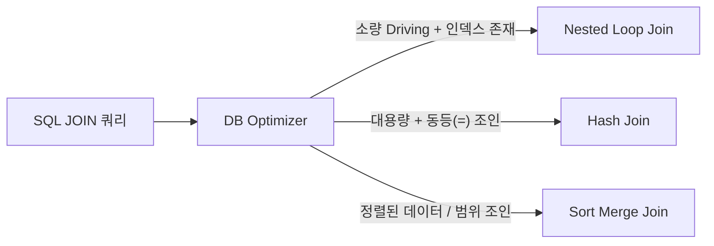

## 1. JOIN이란?

**JOIN(조인)**은 관계형 데이터베이스(RDB)에서 **둘 이상의 테이블을 공통 컬럼(주로 기본키 PK와 외래키 FK)을 기준으로 결합해 하나의 결과 집합으로 조회하는 SQL 연산**입니다.

### 왜 데이터를 나누고 JOIN을 사용할까?

관계형 데이터베이스에서는 데이터 중복을 줄이고 무결성을 유지하기 위해 **정규화(Normalization)**를 통해 테이블을 주제별로 분리합니다.

1. **데이터 중복 제거**: 회원 정보를 주문 테이블에 매번 중복 저장하지 않고 `users` 테이블에 한 번만 보관합니다.
2. **이상 현상(Anomaly) 방지**: 회원이 이름을 변경해도 `users` 테이블의 한 행만 수정하면 되므로 갱신 이상이 발생하지 않습니다.
3. **유연한 데이터 조합**: 저장은 분리해 두되, 조회 시점에 필요한 테이블만 `JOIN`으로 연결해 원하는 형태의 데이터를 얻을 수 있습니다.

> **명시적 JOIN(ANSI SQL) 사용 권장**  
> 과거에는 `FROM users u, orders o WHERE u.id = o.user_id`처럼 `WHERE` 절에 조인 조건을 섞어 쓰는 암시적 조인도 많이 사용했습니다. 하지만 조인 조건과 필터링 조건이 뒤섞여 가독성이 떨어지고, 실수로 조인 조건을 누락하면 카티션 곱이 발생할 수 있으므로 **`INNER JOIN ... ON` 형태의 명시적 ANSI SQL 문법**을 사용하는 것이 좋습니다.
{: .prompt-info }

---

## 2. 주요 JOIN 종류와 예시

이해를 돕기 위해 아래와 같은 **회원(`users`)** 테이블과 **주문(`orders`)** 테이블이 있다고 가정해 보겠습니다.

**`users` 테이블**

| id | name |
| :--- | :--- |
| 1 | 김철수 |
| 2 | 이영희 |
| 3 | 박민수 |

**`orders` 테이블**

| id | user_id | product_name |
| :--- | :--- | :--- |
| 101 | 1 | 키보드 |
| 102 | 1 | 마우스 |
| 103 | 2 | 모니터 |
| 104 | `NULL` | 웹캠 |

*(박민수는 주문 내역이 없고, `104`번 주문은 비회원 주문으로 `user_id`가 `NULL`인 상태입니다.)*

### JOIN 종류 비교

| 종류 | 설명 | 결과 특징 |
| :--- | :--- | :--- |
| **INNER JOIN** | 양쪽 테이블에 **모두 일치하는** 행만 반환 (교집합) | 주문이 있는 회원(`김철수`, `이영희`)과 매칭된 주문만 출력 |
| **LEFT (OUTER) JOIN** | **왼쪽 테이블 전체** + 오른쪽 테이블의 일치하는 행 | 모든 회원 출력 (주문이 없는 `박민수`는 주문 컬럼이 `NULL`) |
| **RIGHT (OUTER) JOIN** | **오른쪽 테이블 전체** + 왼쪽 테이블의 일치하는 행 | 모든 주문 출력 (`user_id`가 없는 `웹캠`은 회원 컬럼이 `NULL`) |
| **FULL (OUTER) JOIN** | **양쪽 테이블의 모든 행**을 합쳐서 반환 (합집합) | 일치하지 않는 쪽은 `NULL`로 채움 *(MySQL은 `UNION`으로 구현)* |
| **CROSS JOIN** | 조건 없이 두 테이블의 **모든 행을 조합** (카티션 곱) | 3행 × 4행 = 총 12행 반환 |
| **SELF JOIN** | **같은 테이블을 자기 자신과** 조인 | 조직도(직원-상사), 카테고리(상위-하위) 등 계층 구조 조회 |

### SQL 작성 예시

```sql
-- 1. INNER JOIN: 주문 내역이 있는 회원과 주문 정보 조회
SELECT u.name, o.product_name
FROM users u
INNER JOIN orders o ON u.id = o.user_id;

-- 2. LEFT OUTER JOIN: 주문 여부와 관계없이 모든 회원 조회 (OUTER 키워드 생략 가능)
SELECT u.name, o.product_name
FROM users u
LEFT JOIN orders o ON u.id = o.user_id;

-- 3. LEFT JOIN + IS NULL (차집합 패턴): 한 번도 주문하지 않은 회원만 조회
SELECT u.name
FROM users u
LEFT JOIN orders o ON u.id = o.user_id
WHERE o.id IS NULL;

-- 4. FULL OUTER JOIN (MySQL에서는 LEFT JOIN과 RIGHT JOIN을 UNION으로 결합)
SELECT u.name, o.product_name
FROM users u
LEFT JOIN orders o ON u.id = o.user_id
UNION
SELECT u.name, o.product_name
FROM users u
RIGHT JOIN orders o ON u.id = o.user_id;

-- 5. SELF JOIN: 직원과 직속 상사의 이름 함께 조회
SELECT e.name AS employee_name, m.name AS manager_name
FROM employees e
LEFT JOIN employees m ON e.manager_id = m.id;
```

---

## 3. DB 내부의 JOIN 동작 방식 (조인 알고리즘)

SQL로 `JOIN`을 작성하면 DB 옵티마이저(Optimizer)가 테이블 크기, 통계 정보, 인덱스 유무를 분석해 가장 비용이 적은 **조인 알고리즘**을 선택해 실행합니다.



| 알고리즘 | 동작 방식 | 유리한 상황 |
| :--- | :--- | :--- |
| **Nested Loop Join (NLJ)** | 선행(Driving) 테이블의 행을 하나씩 읽으며 후행(Driven) 테이블을 반복 탐색 (이중 `for`문과 유사) | Driving 테이블의 결과 건수가 적고, Driven 테이블의 조인 컬럼에 **인덱스가 있을 때** (OLTP 환경에서 가장 일반적) |
| **Hash Join** | 작은 테이블로 메모리에 해시 테이블을 생성(Build)한 뒤, 큰 테이블을 스캔하며 해시 매칭(Probe) | 인덱스가 없거나 **대용량 데이터**를 **동등(`=`) 조건**으로 조인할 때 (배치·통계 쿼리에 유리) |
| **Sort Merge Join** | 양쪽 테이블을 조인 키 기준으로 각각 정렬(Sort)한 뒤, 순차적으로 병합(Merge)하며 매칭 | 조인 조건이 **범위 비교(`<`, `>`, `BETWEEN`)**이거나 데이터가 이미 조인 키로 정렬되어 있을 때 |

> **Driving Table(선행 테이블)과 인덱스의 중요성**  
> Nested Loop Join에서는 먼저 읽는 **Driving 테이블의 결과 행 수가 적을수록** 반복 횟수가 줄어듭니다. 또한 매 반복마다 탐색하는 **Driven 테이블의 조인 컬럼에 인덱스가 있어야** Full Table Scan을 피하고 빠르게 결과를 찾을 수 있습니다.
{: .prompt-tip }

---

## 4. 실무 주의사항

1. **`LEFT JOIN`에서 `ON` 절과 `WHERE` 절의 차이**
   - `ON` 절은 **조인을 수행할 때** 적용되므로, 오른쪽 테이블에 조건을 만족하는 행이 없더라도 왼쪽 테이블의 행은 유지됩니다.
   - 반면 `WHERE` 절은 **조인이 끝난 결과에서 필터링**합니다. 따라서 `LEFT JOIN` 이후 `WHERE` 절에 오른쪽 테이블 컬럼 조건(예: `WHERE o.product_name = '키보드'`)을 걸면 오른쪽이 `NULL`이던 행이 모두 탈락해 사실상 `INNER JOIN`과 동일하게 동작합니다.

> **`LEFT JOIN` 시 필터 조건 위치 주의**  
> 왼쪽 테이블의 행을 유지하면서 오른쪽 테이블의 특정 데이터만 붙이고 싶다면, 오른쪽 테이블의 필터 조건은 `WHERE`가 아니라 반드시 **`ON` 절**에 작성해야 합니다.
{: .prompt-warning }

2. **1:N 조인 시 데이터 뻥튀기(Row Multiplication) 주의**
   - 회원 1명이 주문을 3건 가지고 있으면 `users`와 `orders`를 조인했을 때 해당 회원 행이 3개로 늘어납니다.
   - 이 상태에서 `COUNT(*)`나 `SUM()` 같은 집계 함수를 그대로 사용하면 회원 측 금액이나 건수가 중복 합산되는 버그가 발생합니다. 집계 전에 서브쿼리나 CTE로 먼저 그룹화한 뒤 조인하는 것이 안전합니다.
3. **조인 컬럼의 인덱스와 데이터 타입 일치**
   - 조인 대상 컬럼의 데이터 타입이 서로 다르거나(예: `VARCHAR` vs `INT`), `ON CAST(u.id AS CHAR) = o.user_id`처럼 조인 컬럼을 함수로 가공하면 **묵시적 형변환**이 일어나 인덱스를 사용하지 못할 수 있습니다.
   - 조인에 참여하는 컬럼은 동일한 타입과 문자셋(Collation)으로 설계해야 합니다.
4. **과도한 다중 테이블 조인 지양**
   - 한 쿼리에 너무 많은 테이블을 조인하면 옵티마이저가 최적의 실행 계획을 찾기 어려워지고, 임시 테이블 생성과 메모리 사용량이 급증해 성능이 저하됩니다.
   - 복잡한 조회라면 쿼리를 역할별로 분리하거나, 조회 빈도가 높은 핵심 데이터는 반정규화·캐싱을 함께 고려하는 것이 좋습니다.

---

## 정리

- **JOIN**은 정규화로 분리된 테이블을 공통 컬럼 기준으로 연결해 조회하는 RDB의 핵심 연산이며, 가독성과 안정성을 위해 **명시적 ANSI SQL 문법** 사용을 권장합니다.
- 상황에 맞게 **`INNER` / `LEFT` / `RIGHT` / `FULL` / `CROSS` / `SELF JOIN`**을 선택하고, DB 내부의 **Nested Loop · Hash · Sort Merge Join** 동작 원리를 이해하면 실행 계획(`EXPLAIN`) 분석과 튜닝에 큰 도움이 됩니다.
- 실무에서는 **`LEFT JOIN`의 `ON` vs `WHERE` 구분, 1:N 조인 시 중복 집계 방지, 조인 컬럼의 인덱스·타입 일치**를 반드시 확인해야 합니다.
