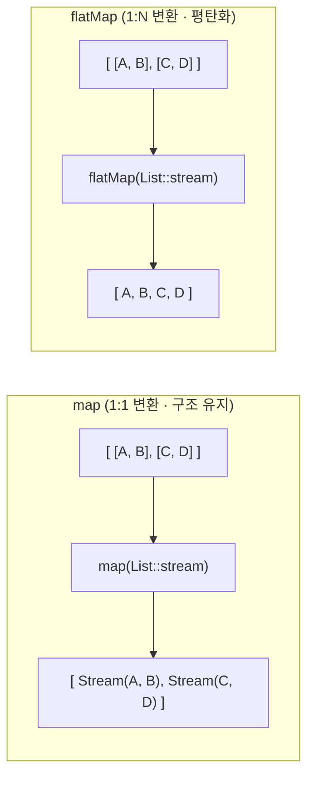

## 1. `map`과 `flatMap`이란?

`map`과 `flatMap`은 Java 8에서 도입된 **Stream API의 대표적인 중간 연산(Intermediate Operation)**으로, 스트림 내부의 각 요소를 원하는 형태로 변환할 때 사용합니다.

두 연산 모두 데이터를 변환한다는 공통점이 있지만, **변환의 대응 관계**와 **중첩 구조의 평탄화(Flattening) 여부**에서 분명한 차이가 있습니다.

- **`map`**: **1:1 변환**을 수행합니다. 스트림의 각 요소를 정확히 하나의 다른 값(또는 객체)으로 변환하며, 변환 후에도 결과 스트림의 요소 개수는 원본과 동일합니다.
- **`flatMap`**: **1:N 변환(또는 1:0 변환)과 평탄화(Flattening)**를 함께 수행합니다. 각 요소를 하나의 스트림으로 변환한 뒤, 생성된 여러 스트림을 **단일 스트림으로 펼쳐서 이어 붙입니다.**

### 동작 구조 비교

중첩된 리스트 `[[A, B], [C, D]]`에 각각 `map`과 `flatMap`을 적용했을 때의 흐름은 다음과 같습니다.



> **이름으로 이해하는 `flatMap`**  
> `flatMap`은 **`flat`(평탄화) + `map`(매핑)**이 합쳐진 이름입니다. 즉, 각 요소를 스트림으로 매핑(`map`)한 뒤 중첩된 스트림 껍질을 벗겨 하나로 평탄화(`flatten`)하는 작업을 한 번에 수행하는 연산입니다.
{: .prompt-info }

---

## 2. 메서드 시그니처와 핵심 차이 비교

`java.util.stream.Stream<T>` 인터페이스에 정의된 두 메서드의 시그니처를 보면 차이가 더욱 명확해집니다.

```java
// map: T를 받아 R 하나를 반환
<R> Stream<R> map(Function<? super T, ? extends R> mapper);

// flatMap: T를 받아 Stream<R>을 반환하고, 이를 하나의 Stream<R>로 평탄화
<R> Stream<R> flatMap(Function<? super T, ? extends Stream<? extends R>> mapper);
```

가장 큰 차이는 **전달하는 람다(`Function`)의 반환 타입**입니다.

- `map`의 매퍼 함수는 단일 값 `R`을 반환합니다. 만약 `R` 자체가 `List<String>`이나 `Stream<String>`이라면 결과도 `Stream<List<String>>`이나 `Stream<Stream<String>>`처럼 중첩된 상태로 남습니다.
- `flatMap`의 매퍼 함수는 반드시 `Stream<? extends R>`을 반환해야 하며, `flatMap` 연산이 내부적으로 각 스트림의 요소를 꺼내 하나의 `Stream<R>`로 합쳐줍니다.

| 구분 | `map` | `flatMap` |
| :--- | :--- | :--- |
| **변환 관계** | **1:1** 변환 | **1:N** 변환 (0개, 1개, 여러 개 모두 가능) |
| **매퍼 함수 반환 타입** | `R` (단일 값 또는 객체) | `Stream<? extends R>` (스트림) |
| **중첩 구조 처리** | 중첩 구조 유지 (`Stream<List<R>>`, `Stream<Stream<R>>`) | 단일 스트림으로 평탄화 (`Stream<R>`) |
| **결과 요소 개수** | 원본 스트림과 항상 동일 | 원본보다 줄어들거나 늘어날 수 있음 |
| **대표 활용 사례** | 필드 추출, 타입 변환, DTO 매핑 | 중첩 컬렉션 펼치기, 문자열 토큰 분리, `Optional` 언래핑 |

---

## 3. 코드로 보는 `map`과 `flatMap`

실무에서 가장 흔히 마주치는 상황은 **객체 안에 리스트가 들어 있는 1:N 구조**입니다. 여러 개의 `Order`(주문) 객체가 각각 `List<String> items`(주문 상품 목록)를 가지고 있을 때, 모든 주문의 상품명을 하나의 리스트로 모으는 예시로 두 연산의 차이를 비교해 보겠습니다.

```java
record Order(Long id, List<String> items) {}

List<Order> orders = List.of(
        new Order(1L, List.of("키보드", "마우스")),
        new Order(2L, List.of("모니터")),
        new Order(3L, List.of("노트북", "거치대"))
);
```

### 1) `map`을 사용한 경우 (중첩 구조 유지)

```java
List<List<String>> nestedItems = orders.stream()
        .map(Order::items)
        .toList();
// 결과: [["키보드", "마우스"], ["모니터"], ["노트북", "거치대"]]
```

`Order` 하나가 `List<String>` 하나로 1:1 매핑되므로 `List<List<String>>` 형태가 됩니다.

### 2) `flatMap`을 사용한 경우 (단일 리스트로 평탄화)

```java
List<String> allItems = orders.stream()
        .flatMap(order -> order.items().stream())
        .toList();
// 결과: ["키보드", "마우스", "모니터", "노트북", "거치대"]
```

각 `Order`의 `items`를 스트림으로 변환한 뒤 `flatMap`으로 펼치면, 모든 상품명이 담긴 단일 `List<String>`을 바로 얻을 수 있습니다.

---

## 4. 실무 주의사항

> **`map`과 `flatMap` 사용 시 자주 겪는 함정**  
> 1. **내부 컬렉션 `null`로 인한 `NullPointerException`**: `flatMap` 매퍼 함수 자체가 `null`을 반환하면 Stream 명세상 빈 스트림으로 처리되지만, `order.items().stream()`처럼 `order.items()`가 `null`인 상태에서 `.stream()`을 호출하면 `NullPointerException`이 발생합니다. `null` 가능성이 있는 컬렉션은 `Stream.ofNullable(order.items()).flatMap(Collection::stream)` 또는 사전 `filter(Objects::nonNull)`로 방어해야 합니다.  
> 2. **매퍼 내부의 부수 효과(Side Effect) 지양**: `map`이나 `flatMap` 안에서 외부 리스트에 값을 추가하거나 객체의 상태를 변경하는 코드는 스트림의 지연 평가(Lazy Evaluation) 특성과 충돌하며, 병렬 스트림(`.parallelStream()`) 전환 시 동시성 버그를 유발합니다. 변환 함수는 상태를 바꾸지 않는 순수 함수로 유지하는 것이 안전합니다.  
> 3. **불필요한 `flatMap` 남용 지양**: 1:1 변환이나 단순 필터링으로 해결할 수 있는 로직에 `flatMap`을 사용하면 요소마다 중간 스트림이 생성되어 불필요한 오버헤드가 발생하고 코드 의도도 흐려집니다.  
> 4. **변환 후 요소 수 변화 인지**: `map`은 요소 개수가 보존되지만 `flatMap`은 빈 스트림이 섞이면 요소가 사라지고, 여러 요소를 내보내면 개수가 늘어납니다. 이후 단계에서 인덱스나 원본과의 1:1 대응을 가정하는 로직이 있다면 주의해야 합니다.
{: .prompt-warning }

---

## 정리

- **`map`**은 스트림의 각 요소를 다른 값 하나로 바꾸는 **1:1 변환** 연산이며, 중첩된 컬렉션이나 스트림 구조를 그대로 유지합니다.
- **`flatMap`**은 각 요소를 스트림으로 변환한 뒤 하나의 스트림으로 펼치는 **1:N 변환 + 평탄화** 연산으로, 중첩 컬렉션이나 다중 값을 단일 스트림으로 다룰 때 활용됩니다.
- 실무에서는 **컬렉션 `null` 방어(`Stream.ofNullable`), 순수 함수 유지(부수 효과 지양), 불필요한 `flatMap` 남용 방지**를 함께 고려하면 안전하고 깔끔한 스트림 파이프라인을 작성할 수 있습니다.
