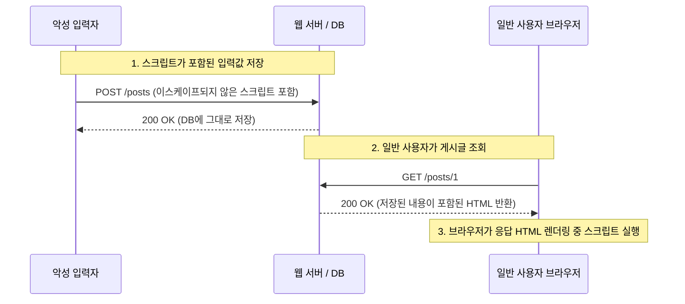

## 1. XSS(Cross-Site Scripting)란?

**XSS(사이트 간 스크립팅)**는 웹 애플리케이션이 사용자 입력값을 적절히 검증하거나 이스케이프(Escape)하지 않고 웹 페이지에 그대로 출력할 때, **의도하지 않은 스크립트(주로 JavaScript)가 다른 사용자의 브라우저에서 실행되는 웹 보안 취약점**입니다.

### 왜 발생할까?

브라우저는 사용자가 접속한 웹사이트가 내려준 HTML 문서 안에 포함된 스크립트를 **정상적인 서비스 코드와 구분하지 못하고 그대로 실행**합니다.

만약 게시글, 댓글, 검색어 같은 사용자 입력 영역에 HTML 태그나 스크립트 구문이 그대로 삽입되어 렌더링되면, 해당 페이지를 열람한 사용자의 브라우저에서 그 스크립트가 **해당 사이트의 동일 출처(Same-Origin) 권한으로 실행**됩니다.

> **XSS가 발생하면 어떤 피해가 생길 수 있을까?**  
> 1. **인증·민감 정보 노출**: `document.cookie`나 `localStorage` 등에 저장된 토큰·세션 정보, 화면에 표시된 개인정보가 외부로 유출될 수 있습니다.  
> 2. **사용자 권한 도용**: 피해자의 브라우저에서 로그인된 상태로 API 요청을 대신 전송해 게시글 작성·정보 변경 등의 작업을 수행할 수 있습니다.  
> 3. **화면 위변조 및 피싱**: 페이지 DOM을 조작해 가짜 로그인 창이나 결제 안내 화면을 띄워 민감 정보 입력을 유도할 수 있습니다.
{: .prompt-info }

---

## 2. XSS의 세 가지 주요 유형

XSS는 스크립트가 삽입되고 실행되는 경로에 따라 크게 세 가지 유형으로 나뉩니다.

### 1) Stored XSS (저장형 / 지속형 XSS)

입력된 스크립트가 **서버의 데이터베이스(DB) 등에 저장**된 뒤, 해당 데이터를 조회하는 모든 사용자의 브라우저에서 반복적으로 실행되는 유형입니다. 게시판 본문, 댓글, 사용자 프로필, 문의 내역 등에서 주로 발생하며, 피해 범위가 가장 넓습니다.



### 2) Reflected XSS (반사형 XSS)

입력값이 서버에 저장되지 않고, **URL 쿼리 파라미터나 폼 입력값이 서버 응답 HTML에 즉시 반사(포함)되어 실행**되는 유형입니다. 검색 결과 페이지(`"OOO"에 대한 검색 결과`), 에러 메시지 출력 화면 등에서 주로 발생합니다.

서버에 영구 저장되지는 않지만, 스크립트가 포함된 링크를 이메일이나 메신저로 전달해 사용자가 클릭하도록 유도하는 방식으로 악용됩니다.

### 3) DOM-based XSS (DOM 기반 XSS)

서버가 내려준 HTML 응답 자체에는 문제가 없으나, **클라이언트 측 JavaScript가 URL(`location.search`, `location.hash`) 등의 입력값을 안전하지 않은 DOM API에 그대로 반영하면서 브라우저 내부에서 실행**되는 유형입니다.

서버 응답 로그에 흔적이 남지 않을 수 있어, 백엔드뿐만 아니라 프론트엔드 코드 레벨의 점검이 필수적입니다.

| 구분 | Stored XSS (저장형) | Reflected XSS (반사형) | DOM-based XSS (DOM 기반) |
| :--- | :--- | :--- | :--- |
| **스크립트 저장 여부** | 서버(DB 등)에 영구 저장 | 저장되지 않음 (1회성) | 저장되지 않음 (클라이언트 처리) |
| **발생 계층** | 서버 측 저장 + 렌더링 | 서버 측 요청 파라미터 렌더링 | 클라이언트 측 JavaScript DOM 조작 |
| **주요 발생 지점** | 게시글, 댓글, 프로필, 리뷰 | 검색어 표시, 에러 메시지, 리다이렉트 | `innerHTML`, `document.write`, `location` 기반 렌더링 |

---

## 3. XSS와 CSRF의 차이

XSS와 CSRF는 모두 웹 브라우저 환경에서 발생하는 대표적인 보안 취약점이지만, 악용하는 신뢰 구조와 방어 방식이 다릅니다.

| 구분 | XSS (Cross-Site Scripting) | CSRF (Cross-Site Request Forgery) |
| :--- | :--- | :--- |
| **악용하는 신뢰 방향** | **사용자가 특정 웹사이트를 신뢰**하는 점을 악용 | **서버가 사용자의 브라우저를 신뢰**하는 점을 악용 |
| **공격 방식** | 정상 사이트에 스크립트를 삽입해 사용자 브라우저에서 실행 | 외부 사이트에서 인증된 사용자의 쿠키를 실어 위조 요청 전송 |
| **응답/데이터 접근** | 동일 출처 권한으로 DOM·응답·스토리지 접근 가능 | 기본적으로 응답 본문이나 쿠키 값을 직접 읽지 못함 |
| **대표 방어 기법** | 출력 이스케이프, HTML 새니타이징, CSP, `HttpOnly` 쿠키 | CSRF 토큰, `SameSite` 쿠키, `Origin` 검증 |

> **XSS가 존재하면 CSRF 방어도 무력화될 수 있습니다.**  
> CSRF 토큰은 외부 출처에서 읽을 수 없다는 점(SOP)을 전제로 동작합니다. 하지만 서비스 내부에 XSS 취약점이 있으면 같은 출처에서 스크립트가 실행되므로 페이지의 CSRF 토큰을 직접 읽어 요청에 포함할 수 있습니다. 따라서 XSS 방어는 웹 보안의 가장 기초가 됩니다.
{: .prompt-tip }

---

## 4. 주요 XSS 방어 기법

XSS는 입력 단계의 검증만으로 완벽히 막기 어렵기 때문에, **출력 시점의 이스케이프를 기본으로 하고 CSP·쿠키 속성 등을 함께 조합하는 다층 방어(Defense in Depth)**를 적용해야 합니다.

### 1) 출력 이스케이프 / 인코딩 (Output Escaping)

가장 근본적인 방어 기법입니다. 사용자 입력값을 HTML에 출력할 때 특수 문자를 HTML 엔티티(Entity)로 치환해 브라우저가 코드가 아닌 **순수 텍스트 데이터**로 해석하도록 만듭니다.

| 원본 문자 | 치환된 HTML 엔티티 |
| :---: | :---: |
| `&` | `&amp;` |
| `<` | `&lt;` |
| `>` | `&gt;` |
| `"` | `&quot;` |
| `'` | `&#x27;` |

React, Vue, Angular, Thymeleaf 같은 최신 프레임워크와 템플릿 엔진은 기본 텍스트 바인딩 시 자동 이스케이프를 제공합니다. 순수 JavaScript로 DOM을 다룰 때도 `innerHTML` 대신 `textContent`를 사용해야 합니다.

```javascript
// 안전하지 않음: 입력값이 HTML로 파싱됨
element.innerHTML = userInput;

// 안전함: 입력값이 순수 텍스트로만 삽입됨
element.textContent = userInput;
```

### 2) HTML 새니타이징 (HTML Sanitization)

게시판의 리치 텍스트 에디터처럼 `<b>`, `<p>`, `<a href="...">` 등 일부 서식 태그를 허용해야 하는 경우에는 단순 이스케이프를 적용할 수 없습니다. 이때는 직접 정규식으로 위험 태그를 걸러내는(블랙리스트) 대신, **검증된 새니타이저 라이브러리(허용 목록 기반)**를 사용해 안전한 태그와 속성만 남기고 나머지를 제거해야 합니다.

- **프론트엔드**: `DOMPurify`
- **백엔드 (Java)**: `OWASP Java HTML Sanitizer`, `jsoup` (`Safelist`)

### 3) CSP (Content Security Policy)

**CSP**는 HTTP 응답 헤더를 통해 브라우저가 **어떤 출처의 스크립트·스타일·리소스만 로드하고 실행할 수 있는지 제한**하는 보안 정책입니다.

애플리케이션 코드에서 실수로 이스케이프가 누락되더라도, 인라인 스크립트 실행을 차단하거나 허용된 도메인 외의 외부 스크립트 로드를 막아 피해를 크게 줄일 수 있습니다.

```http
Content-Security-Policy: default-src 'self'; script-src 'self' https://cdn.example.com; object-src 'none';
```

- `default-src 'self'`: 기본적으로 동일 출처 리소스만 허용
- `script-src 'self' https://cdn.example.com`: 동일 출처와 신뢰하는 CDN의 스크립트만 실행 허용 (인라인 스크립트 차단)
- `object-src 'none'`: 플러그인 기반 오브젝트 실행 차단

### 4) `HttpOnly` 쿠키 속성

세션 쿠키에 `HttpOnly` 속성을 설정하면 클라이언트 측 JavaScript(`document.cookie`)에서 해당 쿠키에 접근할 수 없도록 브라우저가 차단합니다.

```http
Set-Cookie: JSESSIONID=abc123; Path=/; HttpOnly; Secure; SameSite=Lax
```

---

## 5. 실무 주의사항

> **XSS 방어 설계 시 반드시 점검해야 할 항목**  
> 1. **프레임워크의 자동 이스케이프 우회 API 주의**: React의 `dangerouslySetInnerHTML`, Vue의 `v-html`, Thymeleaf의 `th:utext` 등은 HTML을 그대로 렌더링합니다. 불가피하게 사용해야 한다면 반드시 새니타이저(`DOMPurify` 등)를 거친 값만 전달해야 합니다.  
> 2. **URL 속성(`href`, `src`) 검증**: `<a href="...">`나 `window.location`에 사용자 입력 URL을 바인딩할 때 HTML 이스케이프만으로는 `javascript:` 스킴 실행을 막을 수 없습니다. URL 프로토콜이 `http://` 또는 `https://`인지 화이트리스트 방식으로 검증해야 합니다.  
> 3. **`HttpOnly`는 피해 완화 수단일 뿐 근본 방어가 아님**: `HttpOnly`는 쿠키 값 탈취만 막아줄 뿐, 실행된 스크립트가 사용자의 브라우저 권한으로 API를 호출하거나 화면을 조작하는 행위는 막지 못합니다.  
> 4. **출력 컨텍스트에 맞는 인코딩 적용**: HTML 본문, HTML 속성값, JavaScript 문자열, URL 파라미터는 각각 해석 규칙이 다릅니다. 데이터가 삽입되는 위치(Context)에 맞는 인코딩 방식을 사용해야 합니다.
{: .prompt-warning }

---

## 정리

- **XSS**는 검증·이스케이프되지 않은 사용자 입력이 HTML/DOM에 삽입되어 다른 사용자의 브라우저에서 스크립트로 실행되는 취약점으로, 발생 경로에 따라 **Stored, Reflected, DOM-based** 유형으로 나뉩니다.
- 가장 기본적인 방어는 **출력 시점의 컨텍스트별 이스케이프**이며, HTML 태그 허용이 필요한 영역에는 **검증된 새니타이저 라이브러리**를 적용해야 합니다.
- 실무에서는 자동 이스케이프 우회 API(`innerHTML`, `dangerouslySetInnerHTML` 등)와 URL 스킴을 철저히 관리하고, **CSP 헤더**와 **`HttpOnly` 쿠키**를 함께 설정해 다층 방어를 구성하는 것이 안전합니다.
